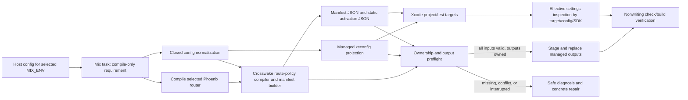

<user_constraints>
## User Constraints (from CONTEXT.md)

### Locked Decisions

### Mandate and remaining judgment

- **D-01:** Carry forward the user's direction to research broadly, resolve tradeoffs into a coherent recommendation set, and avoid making them repeat settled choices. Their “i approve the roadmap” approved the selected synthesis and two-phase scope. There are no unresolved user preference questions for Phase 179; remaining uncertainties require host/Xcode execution. No new questionnaire, research fan-out or automatic plan/execute chain is selected by this invocation.
- **D-02:** Refresh the relevant source facts in an independent qualified preparation surface before planning source edits. Research inspected public source `d0dbdf7bf196cea167ced3c50cf620bf3cb2452b`; the recovery checkout is a different source. Reconcile a changed base explicitly. Do not silently include unrelated recovery files, replay PR #238 delivery, or treat a discussion approval as merge/release authority.

### One build declaration, ordinary Mix lifecycle

- **D-03:** Use one ordinary host-owned build-time configuration declaration under `:crosswake` for iOS host inputs, with `:ios_host` as the selected configuration entry. Normalize a closed input structure at the Mix boundary and pass explicit options to generation functions. Those functions do not fetch global application config. `MIX_ENV` selects the ordinary environment; no second configuration DSL or new lasting CLI override path.
- **D-04:** The supported host input set covers router, primary origin, declared entry route, app identity, proof-app/test identity projections and device signing mode/team selection. Reuse the existing `:proof_lane` owner for unrelated proof settings; do not duplicate identity authority between declarations. Document derivation/validation of test identities. Exact subordinate key names and deterministic suffixes are bounded planner discretion, consistent across examples, normalization, generation and diagnostics.
- **D-05:** Require compilation (`@requirements ["compile"]`) so the selected router is available. Never invoke `app.config`, evaluate `runtime.exs`, start Phoenix or obtain unrelated DB/server credentials merely to generate/check bundle inputs. Avoid manual `Config.Reader` recreation of Mix environment selection. The retained Mix experiment proves the lifecycle distinction only; a genuine host integration check remains necessary.
- **D-06:** Preserve existing documented local/dev invocation and local dependency behavior. The new production configuration path is explicit and fail-closed: no fallback to the example host, placeholder origin or ignored production declaration. Existing flags cannot silently replace declared production inputs. Document compatibility and an explicit migration for edited existing projects; do not remove the existing proof-lane `--config` interface as incidental cleanup.

### Native ownership, inspection and recovery

- **D-07:** Native Swift, entitlements, project customizations and host config are host-owned. Scaffold native files only when missing; never overwrite an edited file based only on its generated-looking path. Refresh only recognized Crosswake-managed manifest/static-activation/build-setting projections. Record ownership sufficiently to distinguish a stale managed output from an unrecognized or externally edited output.
- **D-08:** Initial generation wires the supported project to managed settings. Existing edited projects use a documented opt-in migration with an inspectable bounded change; no arbitrary PBX project editor or generator replacement. Reuse the present Xcode project/templates. Preserve valid host edits; a conflict produces a safe concrete repair rather than a successful partial scaffold.
- **D-09:** `--check` and `--diff` are nonwriting inspections of actual outputs against the selected declaration. They must not create directories, stamps or recovery files. Check fails for missing/stale/invalid/conflicting/incomplete managed outputs. Diff shows safe path/field/status categories and remediation without printing private values or their low-entropy hashes. Do not compare production output to a hardcoded example fixture.
- **D-10:** Validate all inputs, ownership and intended destinations before effects. Stage a coherent output set and replace each file atomically. Detect an interrupted multi-output update and make check/build verification deny mixed generations until explicit recovery completes. Preserve prior recognized state needed for recovery. Do not describe several independent renames as a filesystem-wide atomic transaction; select the smallest recovery mechanism that makes interruption reproducible and repairable.

### Effective Xcode settings and privacy

- **D-11:** Project identity/signing through managed `.xcconfig` files, with explicit unsigned simulator and device-capable settings. Inspect effective settings for shell app, proof app and applicable unit/UI-test targets across Debug/Release and simulator/device SDK classes. Test project wiring and higher-precedence settings rather than asserting that generated text contains the desired keys. Exclude configuration files from bundled resources.
- **D-12:** Simulator checks require no Apple credentials. Device settings inspection proves wiring only: it does not assert provisioning assets, signing success, installation or physical support. Missing device configuration is a concrete device-setup limitation and cannot silently force a production unsigned fallback. Host/Xcode owns certificates, profiles and credentials; no credentials become generator inputs or evidence.
- **D-13:** Keep host-private bundle/team/origin values in normal host-owned config or build environment, never real-adopter Crosswake fixtures. Reports retain safe presence/wiring/outcome categories. Reject invalid values without echoing them. Private diagnostic storage remains subject to the payload/identity privacy rules; raw build settings are not automatically safe to retain.

### Canonical route and activation truth

- **D-14:** Compile the selected host router through the existing route-policy/compiler/manifest builder path. Bundle its declared routes and primary origin; derive static activation from a valid declared entry route and that same origin. A supplied router must determine serialized manifest truth, rather than only capabilities while fixed fixtures remain bundled.
- **D-15:** Validate inputs and reject missing, malformed or example production origins and invalid entry routes before writes. Keep origins in manifest JSON, not an unescaped URL in `.xcconfig` where `//` has comment semantics. Development loopback remains an explicit local mode, not a production-origin default.
- **D-16:** Generated activation is static route/runtime configuration. It grants no session, account, scope, credential, installed-media availability or replay authority. Never project reference fixture pack/auth readiness into production authority. Backend/session and installed verified bytes remain their existing owners; missing authority denies the operation.
- **D-17:** Keep primary route/navigation/bridge origin separate from host-owned auth continuation and media acquisition. Auth/CDN origins do not implicitly become bridge allowlists. No SSO/CDN feature expansion or same-origin relaxation is selected.

### Proof, delivery boundaries and maintainer experience

- **D-18:** Plan feasibility checks first: real host compile/config with deliberately absent runtime-only credentials; effective Xcode settings; edited-file preservation and nonwriting checks; conflict/invalid-input denial; interrupted managed-output detection/recovery; host-derived manifest/entry/origin and static-authority rejection. Use meaningful negative controls, not tests that merely repeat rendered strings. Automate assertions; no human UAT substitutes for these checks.
- **D-19:** Reuse current Elixir/OTP, Swift/Xcode, dependencies and existing relevant CI leaves. Promote only stable recurring generation/ownership contracts; no new permanent simulator/reconciliation workflow, dependency upgrades or Android parity. Phase 180 receives a prepared generated candidate; this phase does not implement its runtime runner or scenario receipt.
- **D-20:** Maintainer flow is declare → inspect → generate → check/build → concrete repair if needed. Output begins with what was checked, its result, the safe cause and one corrective action. Add bounded usage/migration examples and synchronize canonical support/capability guidance and rendered guides only where behavior changes. Use current brand/copy conventions; no UI redesign, dashboard or design-system campaign.
- **D-21:** Preserve all protected historical files at original paths, retained private recovery material, six v24 debt records and six v23 acknowledgements. Phase 175 stays 8/9 with REL-10 breached. No source edits, staging, commits, tags, branch/worktree changes or build/generation runs occur in this recovery checkout. Downstream source work must use a qualified independent surface; its authorization and provenance are part of planning, not silently inherited remote write authority.
- **D-22:** The adopter lane stays parked at Phase 163.1-08 Task 2 until a validated sanitized route handoff exists. That input gate reopens the lane; fresh source-bound signed-device proof is subsequently required for promotion. Simulator/reference generation cannot satisfy either adopter authority or physical support. Stop at the three generation requirements; demonstrated broader core/storage/protocol needs remain incomplete rather than creating new scope.

### Agent Discretion

Choose subordinate config keys, test identity derivation, managed metadata/staging format, exact migration steps and safe diagnostics through idiomatic existing patterns. Resolve these during research/planning without another preference questionnaire, subject to the decisions above. No new product capability, public protocol or permission expansion is discretionary.

### Deferred Ideas (OUT OF SCOPE)

Phase 180 owns the visible generated-WebView/native-media/persistence/replay composition, T01–T10 and derived twin receipt. Physical/adopter promotion remains in the parked adopter lane. Release/PR merge, old debt cleanup, generic sync/storage, Android expansion, new companions/native protocols and brand polish remain excluded. No new deferred idea was introduced during this invocation.
</user_constraints>

<phase_requirements>
## Phase Requirements

| ID | Description | Research Support |
|----|-------------|------------------|
| IOS-01 | Maintainer can declare iOS host build inputs once through ordinary Phoenix/Mix configuration, generate/regenerate supported outputs without unrelated runtime-server credentials, and retain host-owned native edits. Nonwriting check/diff identifies stale output and ownership conflicts without exposing private values. | Compile-only Mix boundary; closed config normalization; classify native versus Crosswake-managed outputs; preflight ownership and all destinations; use nonwriting inspection and interrupted-update recovery. |
| IOS-02 | Maintainer can generate app and proof-test identity/signing projections and verify their effective Xcode settings in simulator/device modes without editing project internals. Simulator checks need no Apple credentials; device settings inspection does not claim signed-device installation. | Managed `.xcconfig` wiring for app/test targets, plus resolved `xcodebuild -showBuildSettings` checks over Debug/Release and simulator/device SDKs; emit only redacted pass/fail categories. |
| IOS-03 | Maintainer can bundle the selected host route declarations, entry route and primary origin through the canonical manifest/static-activation path; missing/example production origin, invalid route/input or interrupted generation fails closed. Generated activation grants no session, scope or replay authority. | Reuse `Crosswake.Manifest.compile/2`, `Crosswake.Manifest.Builder.build/3` and typed static activation with the selected router and origin; keep example fixtures separate and assert authority remains absent. |
</phase_requirements>

# Phase 179: iOS Host Setup Without Hand Patches - Research

**Researched:** 2026-10-13  
**Domain:** Phoenix/Mix build-time configuration, host-owned iOS generation, Xcode effective settings  
**Confidence:** HIGH for source seams and documented platform/config behavior; MEDIUM for the implementation design until full host/Xcode tests run.

## Summary

Use one ordinary host declaration under `:crosswake` / `:ios_host`, normalize it once at the Mix task boundary, and pass a closed value into generation. The selected task must require `compile`, compile the host router, and avoid `app.config`, runtime configuration, and application startup. Official Elixir docs separate build-time config from `runtime.exs`, and the approved minimal Mix experiment tests that lifecycle distinction only; Phase 179 still needs a real Phoenix host integration check. [CITED: https://hexdocs.pm/elixir/1.19.5/config-and-distribution.html#compile-vs-runtime-configuration] [CITED: https://mix.hexdocs.pm/Mix.Tasks.App.Config.html] [VERIFIED: .planning/research/v25/CONFIG-LOADING-RESOLUTION.md]

Keep Swift, entitlements, host configuration, and project customizations host-owned. Generate native scaffold only when absent; regenerate only marked Crosswake-managed manifest, static activation, and settings projections. Make `--check` and `--diff` inspect actual outputs without changing the host tree, make recovery detect a mixed generation, and show only safe causes and a concrete repair. Xcode `.xcconfig` is appropriate for identity/signing settings, but resolved settings must be inspected because target-level settings can override the file. [CITED: https://developer.apple.com/documentation/xcode/adding-a-build-configuration-file-to-your-project] [CITED: https://developer.apple.com/documentation/xcode/configuring-the-build-settings-of-a-target/] [VERIFIED: .planning/workstreams/quality-ratchet-release/phases/179-ios-host-setup-without-hand-patches/179-CONTEXT.md:33-42]

**Primary recommendation:** repair the existing shell generator around one normalized `:ios_host` declaration, canonical router-to-manifest generation, ownership-aware managed projections, and an effective Xcode settings matrix. Start planning with host/config and settings feasibility tests. Do not count the old Mix experiment, current example fixtures, an Xcode version probe, or template-string assertions as full host/Xcode proof. [VERIFIED: d0dbdf7bf196cea167ced3c50cf620bf3cb2452b/lib/mix/tasks/crosswake.gen.shell.ex:63-103,371-391] [VERIFIED: d0dbdf7bf196cea167ced3c50cf620bf3cb2452b/lib/crosswake/shell/fixtures.ex:28-40,43-67] [VERIFIED: .planning/research/v25/SUMMARY.md]

The selected production maintainer flow is inspect, generate, then check/build using the proposed task interface:

```bash
MIX_ENV=prod mix crosswake.gen.shell ios --diff
MIX_ENV=prod mix crosswake.gen.shell ios --check
MIX_ENV=prod mix crosswake.gen.shell ios
```

These are candidate invocations from the locked context, not implemented or executed behavior. Preserve existing documented local/dev invocation and proof-lane `--config`; production inputs come from the selected `:ios_host` declaration. [VERIFIED: .planning/workstreams/quality-ratchet-release/phases/179-ios-host-setup-without-hand-patches/179-CONTEXT.md:128-128]

## Architectural Responsibility Map

| Capability | Primary Tier | Secondary Tier | Rationale |
|------------|-------------|----------------|-----------|
| Read host build declaration and validate generation inputs | Mix build tooling | Phoenix host config | Mix chooses the normal environment and compiles the selected router; a closed normalized input is passed down so generator functions do not consult global config. [VERIFIED: .planning/workstreams/quality-ratchet-release/phases/179-ios-host-setup-without-hand-patches/179-CONTEXT.md:24-29] |
| Compile route policy and write bundled manifest/static activation | Phoenix host router and Crosswake policy compiler | Generated iOS resources | Router declarations determine route truth; activation is a static build projection and never session/replay authority. [VERIFIED: d0dbdf7bf196cea167ced3c50cf620bf3cb2452b/lib/crosswake/manifest/manifest.ex:17-43] [VERIFIED: .planning/workstreams/quality-ratchet-release/phases/179-ios-host-setup-without-hand-patches/179-CONTEXT.md:44-49] |
| App/test identity and signing projection | Xcode build system | Mix-generated `.xcconfig` | Xcode owns effective setting resolution; Mix supplies managed input projections and checks the resolved result. [CITED: https://developer.apple.com/documentation/xcode/configuring-the-build-settings-of-a-target/] |
| Preserve native customizations and repair interrupted output updates | Host project plus Crosswake managed-output owner | Filesystem publication layer | The host owns native edits; Crosswake owns only recognized outputs and must deny a mixed/incomplete generation. [VERIFIED: .planning/workstreams/quality-ratchet-release/phases/179-ios-host-setup-without-hand-patches/179-CONTEXT.md:31-36] |
| Safe diagnostics | Mix task | Host maintainer | Diagnostics should report safe path/field/status categories, concrete cause and one repair without echoing private input or raw Xcode output. [VERIFIED: .planning/workstreams/quality-ratchet-release/phases/179-ios-host-setup-without-hand-patches/179-CONTEXT.md:38-42] |

## Qualified Source and Changed-Base Reconciliation

Refreshed public `main` with a read-only `git ls-remote` and an independent depth-1 clone under `/private/tmp/crosswake-phase179-source`. The public ref still resolves to `d0dbdf7bf196cea167ced3c50cf620bf3cb2452b`; the clone's tree is `12a0f1bf3c32ecdde0326f4a288b597b11e33b06`; `git status --short --branch` returned `## main...origin/main`. This exactly matches the approved research pin and its recorded tree, so no source delta required reconciliation for this research. The recovery checkout is dirty and remains untouched; its source was not used as implementation truth.

Before any future source edit, re-read the public main SHA and qualify a clean independent candidate again. If the SHA or tree changed, compare the new tree against the approved source at the exact file/function seams below, mark superseded observations, and update the plan's source binding before using any old advice. Do not bring recovery-only files or histories into that comparison, search for adopter identity, or treat planning approval as authority for remote delivery. [VERIFIED: .planning/workstreams/quality-ratchet-release/phases/179-ios-host-setup-without-hand-patches/179-CONTEXT.md:21-22,72-98] [VERIFIED: independent public source refresh, 2026-10-13]

## Standard Stack

### Core

| Library/tool | Version | Purpose | Why Standard |
|---------|---------|---------|--------------|
| Elixir / Mix | Elixir 1.19.5; Mix 1.19.5 observed | Compile router and run the host generation/check task | Existing project/toolchain; `compile` is the selected lifecycle requirement. [VERIFIED: local `elixir --version`, `mix --version`] |
| Phoenix host | Example host uses Phoenix `~> 1.8` | Supplies actual router/config for an integration test | Reuse the existing Phoenix reference host and its route compiler path. [VERIFIED: d0dbdf7bf196cea167ced3c50cf620bf3cb2452b/examples/phoenix_host/mix.exs:1-16,70-92; quote: `{:phoenix, "~> 1.8"}`] |
| Xcode / iOS Simulator SDK | Xcode 26.6 build 17F113; iPhoneSimulator SDK 26.5 observed | Resolve effective app/test settings and run simulator-setting checks | Already installed on this machine; no Apple credentials are required for simulator settings inspection. This observation does not prove generated project wiring. [VERIFIED: local `xcodebuild -version`, `xcrun --sdk iphonesimulator --show-sdk-version`] |
| ExUnit | Bundled with current Elixir 1.19.5 | Unit/integration checks for config normalization, ownership, route projection, and recovery | Existing test framework and generator regression corpus. [VERIFIED: local Elixir version; d0dbdf7bf196cea167ced3c50cf620bf3cb2452b/test/mix/tasks/crosswake_gen_shell_test.exs:1-14] |

### Supporting

| Library/tool | Version | Purpose | When to Use |
|---------|---------|---------|-------------|
| `xcodebuild` | Xcode 26.6 | `-showBuildSettings [-json]` inspection by target/configuration/SDK | Use for resolved settings only; filter output in memory to safe pass/fail categories. [VERIFIED: local `xcodebuild -help`; CITED: https://developer.apple.com/documentation/xcode/xcode-command-line-tool-reference] |
| `:crosswake` route-policy/manifest APIs | Current pinned source | Compile selected router and canonical serialized routes | Use existing `Crosswake.Manifest.compile/2` and `Crosswake.Manifest.Builder.build/3` path. [VERIFIED: d0dbdf7bf196cea167ced3c50cf620bf3cb2452b/lib/crosswake/manifest/manifest.ex:17-43; lib/crosswake/manifest/builder.ex:40-83] |

### Alternatives Considered

| Instead of | Could Use | Tradeoff |
|------------|-----------|----------|
| One host-owned build declaration selected through `MIX_ENV` | Add another CLI/config-file source of truth | Adds precedence and repeats host router/origin/identity. Keep the existing proof-lane `--config` interface for its own settings; do not use it as a second iOS host authority. [VERIFIED: .planning/workstreams/quality-ratchet-release/phases/179-ios-host-setup-without-hand-patches/179-CONTEXT.md:24-29] |
| Managed `.xcconfig` references and Xcode resolved-setting checks | Rewrite arbitrary PBX project settings on each run | Risks overwriting host changes and still misses higher-precedence target overrides. Apply only the bounded initial wiring and explicit opt-in migration. [CITED: https://developer.apple.com/documentation/xcode/configuring-the-build-settings-of-a-target/] |
| Canonical manifest builder plus static activation | Reuse the current fixed example fixture for production | The fixture exporter serializes a dashboard route and default origin rather than the supplied host router. Keep it for reference/dev only. [VERIFIED: d0dbdf7bf196cea167ced3c50cf620bf3cb2452b/lib/crosswake/shell/fixtures.ex:43-80] |

**Installation:** none. This phase adds no external package dependency. No registry or package-legitimacy check is applicable.

## Architecture Patterns

### System Architecture Diagram



**Flow boundary:** Xcode settings establish target wiring only. Static activation carries route/runtime configuration, not account/session/scope/credential/replay authority. Host auth and media origins remain independently owned. [VERIFIED: .planning/workstreams/quality-ratchet-release/phases/179-ios-host-setup-without-hand-patches/179-CONTEXT.md:44-49]

### Recommended Project Structure

Existing source seams to retain:

```text
lib/mix/tasks/crosswake.gen.shell.ex                 # task lifecycle and generation dispatch
lib/crosswake/manifest/manifest.ex                    # route compile/validate/render boundary
lib/crosswake/manifest/builder.ex                     # typed manifest and explicit origin option
lib/crosswake/shell/activation.ex                     # typed activation request/decision
lib/crosswake/shell/fixtures.ex                       # reference/dev fixture exporter only
lib/mix/tasks/crosswake.gen.proof_lane.ex             # config/check/diff precedent
lib/crosswake/proof_lane/config.ex                    # closed normalization precedent
lib/crosswake/proof_lane/generator.ex                 # ownership/check/diff precedent
lib/crosswake/proof_lane/generator_fs.ex               # contained filesystem helper precedent
priv/templates/crosswake/shell/ios/                   # existing shell templates
priv/templates/crosswake/proof_lane/ios/              # proof app/test templates
test/mix/tasks/crosswake_gen_shell_test.exs           # shell generation regressions
test/mix/tasks/crosswake_gen_shell_diff_test.exs      # read-only diff regressions
test/mix/tasks/crosswake_gen_shell_stamp_test.exs     # stamp/template regressions
test/mix/tasks/crosswake_gen_proof_lane_test.exs      # ownership/check/diff/recovery patterns
```

These paths are present in the qualified source. [VERIFIED: d0dbdf7bf196cea167ced3c50cf620bf3cb2452b/lib/mix/tasks/crosswake.gen.shell.ex:1-19,371-391; lib/crosswake/manifest/manifest.ex:1-43; lib/crosswake/manifest/builder.ex:1-83; lib/crosswake/shell/activation.ex:1-124; lib/crosswake/shell/fixtures.ex:1-120; lib/crosswake/proof_lane/generator.ex:1-190]

Proposed new internal modules, subject to planner file grouping: `Crosswake.Shell.IOSHostConfig` for closed normalization/validation and `Crosswake.Shell.ManagedOutputs` for ownership inventory, staged publication, check/diff, and interrupted-update recovery. These module names and file paths are recommendations, not existing source or locked public API. [ASSUMED]

### Pattern 1: Normalize Once at the Mix Boundary

**What:** The Mix task reads the selected `:crosswake, :ios_host` declaration after its compile requirement, normalizes it to a closed struct, and passes explicit options into pure generation functions. No generator function calls `Application.get_env/3` or recreates `MIX_ENV` selection. [VERIFIED: .planning/workstreams/quality-ratchet-release/phases/179-ios-host-setup-without-hand-patches/179-CONTEXT.md:24-29] [CITED: https://hexdocs.pm/elixir/1.19.5/config-and-distribution.html#compile-vs-runtime-configuration]

**When to use:** For generation and check/diff commands that require the selected router and build-time host values but must not configure/start the running host.

**Example:**

```elixir
@requirements ["compile"]

def run(args) do
  declaration = Application.fetch_env!(:crosswake, :ios_host)
  with {:ok, inputs} <- IOSHostConfig.normalize(declaration) do
    run_generation_or_inspection(args, inputs)
  end
end
```

The requirement and selected app-config lookup are verbatim from the locked resolution; `IOSHostConfig` and helper names are proposed internal names. [VERIFIED: .planning/workstreams/quality-ratchet-release/phases/179-ios-host-setup-without-hand-patches/179-CONTEXT.md:26-29] [VERIFIED: .planning/research/v25/CONFIG-LOADING-RESOLUTION.md] [ASSUMED: proposed helper names]

### Pattern 2: Publish Only Recognized Managed Projections

**What:** Validate config, ownership, and all destination paths before effects. Preserve host-owned Swift/project/config edits. Stage manifest, activation, and settings output as one generation; use per-file atomic replacement, retain a recovery record for the old recognized set, and make `--check`/build verification fail while that record indicates a mixed update. Do not claim the separate renames are one filesystem transaction. [VERIFIED: .planning/workstreams/quality-ratchet-release/phases/179-ios-host-setup-without-hand-patches/179-CONTEXT.md:31-36]

**When to use:** Generation, migration, or repair of an existing host. A file that resembles generated output but lacks recognized ownership must stop with a safe repair instruction.

**Implementation lead:** The existing proof-lane generator has contained reads/writes, missing-only scaffold preservation, check/diff, and an interruption seam. Reuse its tests and filesystem boundary as a pattern, but do not treat its current missing-only generator or one-file provenance manifest as sufficient multi-file recovery. [VERIFIED: d0dbdf7bf196cea167ced3c50cf620bf3cb2452b/lib/crosswake/proof_lane/generator.ex:34-89,101-171] [VERIFIED: d0dbdf7bf196cea167ced3c50cf620bf3cb2452b/test/mix/tasks/crosswake_gen_proof_lane_test.exs:45-160]

### Pattern 3: Inspect Effective Xcode Settings

Xcode layers project, configuration-file, and target settings; target values have precedence over target-mapped `.xcconfig` values. `xcodebuild` command-line overrides have still higher precedence, so the validation command must not pass the identities/signing values it intends to verify as command-line overrides. Use `-showBuildSettings` and compare the resolved settings to the selected declaration in memory, emitting only category and pass/fail. Do not retain raw JSON or print private bundle/team values. [CITED: https://developer.apple.com/documentation/xcode/configuring-the-build-settings-of-a-target/] [CITED: https://developer.apple.com/documentation/xcode/adding-a-build-configuration-file-to-your-project]

**Target names read verbatim from current templates:** shell target declarations contain `name = CrosswakeShell;` and `name = CrosswakeShellTests;` [VERIFIED: d0dbdf7bf196cea167ced3c50cf620bf3cb2452b/priv/templates/crosswake/shell/ios/CrosswakeShell.xcodeproj/project.pbxproj.eex:143-178]. Proof target declarations contain `name = CrosswakeProofLane;`, `name = CrosswakeProofLaneTests;`, and `name = CrosswakeProofLaneUITests;` [VERIFIED: d0dbdf7bf196cea167ced3c50cf620bf3cb2452b/priv/templates/crosswake/proof_lane/ios/CrosswakeProofLane.xcodeproj/project.pbxproj.eex:41-45]. Both templates contain `name = Debug;` and `name = Release;`; shell settings list `SUPPORTED_PLATFORMS = "iphonesimulator iphoneos";` and proof settings set `SDKROOT = iphoneos;`. [VERIFIED: d0dbdf7bf196cea167ced3c50cf620bf3cb2452b/priv/templates/crosswake/shell/ios/CrosswakeShell.xcodeproj/project.pbxproj.eex:267-402; priv/templates/crosswake/proof_lane/ios/CrosswakeProofLane.xcodeproj/project.pbxproj.eex:71-77]

**Proposed command shape** (repeat over the five quoted targets, `Debug`/`Release`, and `iphonesimulator`/`iphoneos`; use generated candidate paths):

```sh
xcodebuild -project "$PROJECT" -target "$TARGET" \
  -configuration "$CONFIGURATION" -sdk "$SDK" -showBuildSettings -json
```

The command-line syntax is supported by the installed Xcode help output and Apple’s command-line reference. Its output is sensitive: consume in process memory, compare allowlisted settings, and report target + SDK/config classes + pass/fail only. Do not persist the raw build-settings response. [VERIFIED: local `xcodebuild -help`] [CITED: https://developer.apple.com/documentation/xcode/xcode-command-line-tool-reference] [ASSUMED: filtered report implementation]

### Anti-Patterns to Avoid

- **Require `app.config` or start Phoenix:** it evaluates runtime configuration, which can demand unrelated server credentials. Use the locked compile requirement. [CITED: https://mix.hexdocs.pm/Mix.Tasks.App.Config.html] [VERIFIED: .planning/research/v25/CONFIG-LOADING-RESOLUTION.md]
- **Treat `Fixtures.export/1` as production generation:** it currently returns fixed reference fixture routes/origin and simulated pack state. Keep it for sample/dev behavior, not host route truth. [VERIFIED: d0dbdf7bf196cea167ced3c50cf620bf3cb2452b/lib/crosswake/shell/fixtures.ex:28-40,43-80]
- **Rewrite PBX internals on each invocation:** use the existing templates for first wiring and a bounded opt-in migration; preserve arbitrary host-owned Xcode edits. [VERIFIED: .planning/workstreams/quality-ratchet-release/phases/179-ios-host-setup-without-hand-patches/179-CONTEXT.md:31-36]
- **Verify only generated text:** hardcoded target settings can mask `.xcconfig` values. Assert effective settings and include a deliberately higher-precedence masking negative case. [CITED: https://developer.apple.com/documentation/xcode/configuring-the-build-settings-of-a-target/]
- **Write origins into `.xcconfig`:** `//` begins an Xcode config comment. Keep primary origin in canonical manifest JSON. [VERIFIED: .planning/workstreams/quality-ratchet-release/phases/179-ios-host-setup-without-hand-patches/179-CONTEXT.md:44-49] [CITED: https://developer.apple.com/documentation/xcode/adding-a-build-configuration-file-to-your-project]
- **Print private settings in diffs or evidence:** never echo host origin, bundle/team values, low-entropy hashes, credentials, or unfiltered Xcode output. [VERIFIED: .planning/workstreams/quality-ratchet-release/phases/179-ios-host-setup-without-hand-patches/179-CONTEXT.md:38-42]
- **Claim transaction-wide atomicity:** separate replacements need an interruption marker/recovery path; check/build must reject mixed generations. [VERIFIED: .planning/workstreams/quality-ratchet-release/phases/179-ios-host-setup-without-hand-patches/179-CONTEXT.md:33-36]

## Don't Hand-Roll

| Problem | Don't Build | Use Instead | Why |
|---------|-------------|-------------|-----|
| Phoenix route manifest serialization | Second route DSL or custom serializer | `Crosswake.Manifest.compile/2`, `Crosswake.Manifest.Builder.build/3`, canonical renderer | Existing compiler and builder already apply route policy, typed manifest construction, validation, and serialization. [VERIFIED: d0dbdf7bf196cea167ced3c50cf620bf3cb2452b/lib/crosswake/manifest/manifest.ex:17-43; lib/crosswake/manifest/builder.ex:40-83] |
| Static activation decision | Copy example activation JSON or treat it as auth | Existing `Crosswake.Shell.Activation` request/map contract derived from selected route/origin | Preserves the typed route gate while keeping session/scope/replay authority outside build-time config. [VERIFIED: d0dbdf7bf196cea167ced3c50cf620bf3cb2452b/lib/crosswake/shell/activation.ex:73-123] |
| Xcode settings precedence | Parse `.pbxproj` text and infer effective values | Xcode `-showBuildSettings` for each target/configuration/SDK | Xcode merges levels and target settings can override config-file values. [CITED: https://developer.apple.com/documentation/xcode/configuring-the-build-settings-of-a-target/] |
| Secure contained output access | New ad hoc symlink/path traversal and atomic-write layer | Existing `Crosswake.ProofLane.GeneratorFS` as a reviewed pattern, extended only for managed replace/recovery semantics | It already has contained filesystem operations and explicit error categories; its missing-only policy is insufficient alone for refreshing managed outputs. [VERIFIED: d0dbdf7bf196cea167ced3c50cf620bf3cb2452b/lib/crosswake/proof_lane/generator_fs.ex:1-83] [VERIFIED: d0dbdf7bf196cea167ced3c50cf620bf3cb2452b/lib/crosswake/proof_lane/generator.ex:101-171] |

**Key insight:** the difficult boundary is identifying exactly which bytes Crosswake may refresh while a host owns the rest of an editable Xcode project. Keep ownership metadata closed and non-sensitive, and keep static route policy separate from runtime authority. [VERIFIED: .planning/workstreams/quality-ratchet-release/phases/179-ios-host-setup-without-hand-patches/179-CONTEXT.md:31-49]

## Common Pitfalls

### Pitfall 1: Runtime config leaks into the generator lifecycle

**What goes wrong:** A production generation command fails on absent DB/server credentials or starts the host just to read router/config.  
**Why it happens:** `app.config` evaluates `runtime.exs`; ordinary build config is already selected by Mix.  
**How to avoid:** Set the task requirement to `compile`, normalize the loaded `:ios_host` declaration, and use no manual `Config.Reader` or app start.  
**Warning signs:** Task metadata says `app.config`, generated shell tests set server credentials, or application supervision starts in a check. [CITED: https://mix.hexdocs.pm/Mix.Tasks.App.Config.html] [CITED: https://hexdocs.pm/elixir/1.19.5/config-and-distribution.html#compile-vs-runtime-configuration]

### Pitfall 2: The configured router is not the serialized manifest source

**What goes wrong:** Capabilities come from the selected router while the bundled routes/origin/activation still come from fixed fixtures.  
**Why it happens:** Current `run/1` passes the router to capability extraction, but `generate_ios_shell/4` calls `Fixtures.export("ios")` separately.  
**How to avoid:** Compile the selected router once through `Crosswake.Manifest.compile/2`, build with its `origin` option, serialize that typed manifest, and derive static activation from the declared entry route and same origin.  
**Warning signs:** Changing the selected router alters capability IDs but leaves route IDs and origin unchanged. [VERIFIED: d0dbdf7bf196cea167ced3c50cf620bf3cb2452b/lib/mix/tasks/crosswake.gen.shell.ex:63-90,371-381,510-520; lib/crosswake/shell/fixtures.ex:28-40,43-80] [VERIFIED: d0dbdf7bf196cea167ced3c50cf620bf3cb2452b/lib/crosswake/manifest/builder.ex:40-83]

### Pitfall 3: Managed outputs and host edits are confused

**What goes wrong:** A refresh clobbers a real host edit, or it preserves stale production manifest/settings because everything is treated as missing-only.  
**Why it happens:** Current shell scaffolding preserves all existing template files; proof-lane scaffolding also preserves files but checks only its managed provenance outputs.  
**How to avoid:** Maintain a closed allowlist of managed projections and recognized ownership metadata. Create native scaffold only when missing. Detect unknown/externally edited content before any write, with no partial scaffold on conflict.  
**Warning signs:** A successful run reports a stale manifest as current or refreshes `.pbxproj`, Swift, entitlements, or host config. [VERIFIED: d0dbdf7bf196cea167ced3c50cf620bf3cb2452b/lib/mix/tasks/crosswake.gen.shell.ex:371-381,427-435,555-589; lib/crosswake/proof_lane/generator.ex:101-123]

### Pitfall 4: Multi-output interruption looks like success

**What goes wrong:** Manifest and settings files come from different declarations after a crash, yet `--check` or a build accepts them.  
**Why it happens:** Per-file replacement is atomic but a set of files is not a filesystem-wide transaction.  
**How to avoid:** Prevalidate all destinations, stage the complete desired set and prior recognized state, publish an interruption marker, replace files individually, then clear the marker only after verification. A remaining marker makes all check/build verification deny until explicit recovery restores or completes a coherent set. Do not include private values or their hashes in the marker.  
**Warning signs:** Check creates directories/stamps, ignores a journal, or sees the manifest as current while the `.xcconfig` is stale. [VERIFIED: .planning/workstreams/quality-ratchet-release/phases/179-ios-host-setup-without-hand-patches/179-CONTEXT.md:33-36] [ASSUMED: marker/staging mechanics]

### Pitfall 5: Xcode project values mask managed configuration

**What goes wrong:** The generated `.xcconfig` contains expected identity/signing values while the actual target still resolves to template defaults or simulator-only signing settings.  
**Why it happens:** Target-level settings outrank target-mapped `.xcconfig` values. Current templates hard-code settings at multiple layers.  
**How to avoid:** Wire managed settings into the project targets once, replace the template's hardcoded identity/signing authority with setting references, then inspect resolved settings for all targets/configurations/SDK classes without passing overriding CLI values.  
**Warning signs:** Settings are validated with grep only, or the test command sets the exact expected identity on the command line. [CITED: https://developer.apple.com/documentation/xcode/configuring-the-build-settings-of-a-target/] [VERIFIED: d0dbdf7bf196cea167ced3c50cf620bf3cb2452b/priv/templates/crosswake/shell/ios/CrosswakeShell.xcodeproj/project.pbxproj.eex:267-402; priv/templates/crosswake/proof_lane/ios/CrosswakeProofLane.xcodeproj/project.pbxproj.eex:71-77]

## Code Examples

### Compile the selected host config without starting its runtime

The exact task requirement and configuration owner are locked: `@requirements ["compile"]` and `config :crosswake, :ios_host`. The selected environment remains ordinary `MIX_ENV`; generator functions receive explicit normalized options. [VERIFIED: .planning/workstreams/quality-ratchet-release/phases/179-ios-host-setup-without-hand-patches/179-CONTEXT.md:24-29] [CITED: https://hexdocs.pm/elixir/1.19.5/config-and-distribution.html#compile-vs-runtime-configuration]

```elixir
@requirements ["compile"]

def run(_args) do
  config = Application.fetch_env!(:crosswake, :ios_host)
  with {:ok, inputs} <- IOSHostConfig.normalize(config) do
    generate_or_inspect(inputs)
  end
end
```

`IOSHostConfig` and `generate_or_inspect/1` above are proposed internal names [ASSUMED]; the lifecycle and config owner are the selected decisions.

### Inspect a resolved setting matrix

```sh
xcodebuild -project "$PROJECT" -target "$TARGET" \
  -configuration "$CONFIGURATION" -sdk "$SDK" -showBuildSettings -json
```

Use this for targets whose current templates state `name = CrosswakeShell;`, `name = CrosswakeShellTests;`, `name = CrosswakeProofLane;`, `name = CrosswakeProofLaneTests;`, and `name = CrosswakeProofLaneUITests;`; configurations are `name = Debug;` and `name = Release;`; SDK classes are `iphonesimulator` and `iphoneos`. These values are quoted verbatim above from current source. [VERIFIED: d0dbdf7bf196cea167ced3c50cf620bf3cb2452b/priv/templates/crosswake/shell/ios/CrosswakeShell.xcodeproj/project.pbxproj.eex:143-178,267-402; priv/templates/crosswake/proof_lane/ios/CrosswakeProofLane.xcodeproj/project.pbxproj.eex:41-45,71-77] [VERIFIED: local `xcodebuild -help`]

The command is inspection only. Validate target/setting presence and expected signing mode in memory; retain a redacted result, not raw JSON. Device settings prove wiring only, not provisioning or installation. [VERIFIED: .planning/workstreams/quality-ratchet-release/phases/179-ios-host-setup-without-hand-patches/179-CONTEXT.md:38-42] [CITED: https://developer.apple.com/documentation/xcode/xcode-command-line-tool-reference]

## State of the Art

| Old Approach | Current Approach | When Changed | Impact |
|--------------|------------------|--------------|--------|
| Shell task uses a router to derive capability IDs but exports fixed fixture routes and default origin | Compile the supplied host router to the canonical manifest and derive activation from its selected entry/origin | Phase 179 approved design, 2026-10-13 | Host route declarations become serialized truth while example fixtures remain sample-only. [VERIFIED: d0dbdf7bf196cea167ced3c50cf620bf3cb2452b/lib/mix/tasks/crosswake.gen.shell.ex:63-90,371-381; lib/crosswake/shell/fixtures.ex:28-40,43-80] [VERIFIED: .planning/workstreams/quality-ratchet-release/phases/179-ios-host-setup-without-hand-patches/179-CONTEXT.md:44-49] |
| Hardcoded project signing/identity text is treated as sufficient setup | Managed `.xcconfig` plus resolved-setting checks across target/configuration/SDK classes | Phase 179 approved design, 2026-10-13 | Finds precedence masking without arbitrary PBX rewrite or signed-device overclaim. [CITED: https://developer.apple.com/documentation/xcode/configuring-the-build-settings-of-a-target/] |
| Existing shell generation is scaffold-once | Host-owned native scaffold remains missing-only; recognized managed projections get ownership-aware refresh and recovery | Phase 179 approved design, 2026-10-13 | Enables safe updates without clobbering native edits or accepting mixed output. [VERIFIED: .planning/workstreams/quality-ratchet-release/phases/179-ios-host-setup-without-hand-patches/179-CONTEXT.md:31-36] |

**Deprecated/outdated:** Do not describe the current shell generator as safely regeneratable; its current output path preserves existing template files and writes a sidecar independently. Do not claim the old small Mix lifecycle experiment proves full Phoenix/Xcode behavior. [VERIFIED: d0dbdf7bf196cea167ced3c50cf620bf3cb2452b/lib/mix/tasks/crosswake.gen.shell.ex:371-381,555-589] [VERIFIED: .planning/research/v25/CONFIG-LOADING-RESOLUTION.md]

## Project Constraints (from AGENTS.md)

- Keep Crosswake Phoenix-first and route-policy/runtime-contract focused; preserve explicit route runtime ownership and typed, versioned, low-frequency bridge contracts. [VERIFIED: AGENTS.md:39-50]
- Keep offline claims bounded; preserve explicit fail-closed denials and host/backend authority. [VERIFIED: AGENTS.md:47-50,61-72]
- Never place real adopter identity, customer/product data, answers, media, transcripts, credentials, account identifiers, tokens, or stable device identifiers in fixtures, diagnostics, logs, inspection, aggregates, or proof artifacts. [VERIFIED: AGENTS.md:61-72]
- Keep Android at its frozen current posture; do not add Android features/templates/device proof/parity/release requirements in this scope. [VERIFIED: AGENTS.md:55-59]
- Automate all automatable acceptance; no human UAT or `checkpoint:human-verify` for claims covered by executable checks. Promote only recurring stable checks to existing CI; do not create a standing one-time simulator lane. [VERIFIED: AGENTS.md:94-102]
- Keep this workstream explicit and report its exact state handoff; Phase 178 is the last completed phase, discussion is complete, and the next command is `$gsd-plan-phase 179 --ws quality-ratchet-release`. [VERIFIED: .planning/workstreams/quality-ratchet-release/STATE.md:29-43]
- In this recovery checkout, do not write source, stage, commit, tag, change branches/worktrees, build, or generate. Research output may be written to its phase-local artifact path; downstream source edits belong in a qualified independent candidate. [VERIFIED: .planning/workstreams/quality-ratchet-release/phases/179-ios-host-setup-without-hand-patches/179-CONTEXT.md:51-59]

## Environment Availability

| Dependency | Required By | Available | Version | Fallback |
|------------|------------|-----------|---------|----------|
| Elixir / Mix | Real host compile and generation task | ✓ | Elixir 1.19.5 / Mix 1.19.5 | None needed for planning; do not run generation in recovery. |
| Xcode / `xcodebuild` | Effective settings inspection | ✓ | Xcode 26.6, build 17F113 | No Apple credentials needed for simulator settings; device settings remain wiring-only. |
| iPhoneSimulator SDK | Simulator SDK class settings | ✓ | 26.5 | None observed. |
| Node for repository verification wrapper | Existing `repository-preflight` stage | ✓, wrong expected version | Local v26.10.0; source stage expects `^v22.14.0$` | Use project-pinned Node before running repository verification. [VERIFIED: d0dbdf7bf196cea167ced3c50cf620bf3cb2452b/script/repository_verification_stages.json:1-18; quote: `"version_regex": "^v22\\.14\\.0$"`] |
| Real adopter host configuration | Host-specific config and actual router integration | Not supplied as a separate host in this session; repository Phoenix example exists | — | Use `examples/phoenix_host` as a real Phoenix integration host where it satisfies the required host facts; use a synthetic runtime-config sentinel only as a negative control, never as substitute full-host evidence. [VERIFIED: d0dbdf7bf196cea167ced3c50cf620bf3cb2452b/examples/phoenix_host/mix.exs:1-16,70-92] [ASSUMED: target adopter host availability] |

**Missing dependencies with no fallback:** None for planning. Do not claim device signing or installation from settings inspection.

## Validation Architecture

Nyquist validation is enabled: `.planning/config.json` has `"nyquist_validation": true`. The existing framework is ExUnit with the project-supported Elixir 1.19.5/Mix 1.19.5. No validation command was executed in this research turn; source generation, Xcode project inspection, test runs, and builds were intentionally not performed in recovery. [VERIFIED: .planning/config.json] [VERIFIED: local `elixir --version`, `mix --version`]

### Test Framework

| Property | Value |
|----------|-------|
| Framework | ExUnit (Elixir 1.19.5) |
| Config file | `test/test_helper.exs`; Mix project config in `mix.exs` |
| Quick run command | `MIX_ENV=test mix test test/mix/tasks/crosswake_gen_shell_test.exs test/mix/tasks/crosswake_gen_shell_diff_test.exs test/mix/tasks/crosswake_gen_shell_stamp_test.exs test/mix/tasks/crosswake_gen_proof_lane_test.exs` |
| Full suite command | `MIX_ENV=test mix verify` (existing `root-proof` runner command) |

The test paths are present and their current cases exercise generation, diff, and proof-lane preservation/recovery. [VERIFIED: d0dbdf7bf196cea167ced3c50cf620bf3cb2452b/test/mix/tasks/crosswake_gen_shell_test.exs:49-144; test/mix/tasks/crosswake_gen_shell_diff_test.exs:44-149; test/mix/tasks/crosswake_gen_shell_stamp_test.exs:55-180; test/mix/tasks/crosswake_gen_proof_lane_test.exs:45-160]

### Phase Requirements → Test Map

| Req ID | Behavior | Test Type | Automated Command | File Exists? |
|---------|----------|------------|-------------------|-------------|
| IOS-01 | Compile/config path reads ordinary build config with a deliberately absent runtime-only sentinel and no app startup; valid host edits survive; `--check`/`--diff` do not mutate host tree; unknown ownership and interrupted generation fail closed | ExUnit + reference-host integration | `MIX_ENV=test mix test test/mix/tasks/crosswake_gen_shell_test.exs test/mix/tasks/crosswake_gen_shell_diff_test.exs test/mix/tasks/crosswake_gen_proof_lane_test.exs` | Existing files exist; add phase-specific config/managed-output tests. |
| IOS-02 | Resolved app, proof app, unit/UI-test identities and signing settings match the selected declaration in Debug/Release and simulator/device SDK classes; a target-level override negative control is detected; no credentials required for simulator inspection | Xcode project/settings test + safe-output assertion | `xcodebuild -project "$PROJECT" -target "$TARGET" -configuration "$CONFIGURATION" -sdk "$SDK" -showBuildSettings -json` (iterate the five source-quoted targets and matrix classes; stream-filter raw output) | Existing project templates exist; no effective-settings matrix test exists yet. |
| IOS-03 | Selected router changes serialized route set and origin; invalid/example production origin and entry route fail before writes; activation contains no runtime authority; interruption prevents mixed-generation success | ExUnit + Phoenix host integration | `MIX_ENV=test mix test test/crosswake/manifest/manifest_test.exs test/crosswake/manifest/builder_test.exs test/crosswake/shell/activation_test.exs test/mix/tasks/crosswake_gen_shell_test.exs` | Manifest/activation tests exist; add generator host-route/authority/negative cases. |

### Useful New Negative Controls

- A real Phoenix host task succeeds when runtime-only credential variables are unset and leaves the application stopped; pair it with a small temporary Mix fixture whose `runtime.exs` throws if evaluated. The pre-existing minimal experiment only proves the second lifecycle distinction and must not be counted as full host proof. [VERIFIED: .planning/research/v25/CONFIG-LOADING-RESOLUTION.md]
- Change the host router or declared entry route and assert exact resulting manifest/activation route identities change; assert the default/example fixture values cannot pass production generation. [VERIFIED: d0dbdf7bf196cea167ced3c50cf620bf3cb2452b/lib/mix/tasks/crosswake.gen.shell.ex:371-381; lib/crosswake/shell/fixtures.ex:43-80] [VERIFIED: .planning/workstreams/quality-ratchet-release/phases/179-ios-host-setup-without-hand-patches/179-CONTEXT.md:44-49]
- Snapshot target output before and after `--check` and `--diff`; assert no host directories, stamps, markers, or recovery files were added and private values/hashes do not appear in output. [VERIFIED: d0dbdf7bf196cea167ced3c50cf620bf3cb2452b/test/mix/tasks/crosswake_gen_proof_lane_test.exs:114-143] [VERIFIED: .planning/workstreams/quality-ratchet-release/phases/179-ios-host-setup-without-hand-patches/179-CONTEXT.md:33-36]
- Preserve a host edit in Swift or Xcode configuration; separately mutate a recognized managed resource and an unrecognized resource, requiring a safe conflict/repair result before any file changes. [VERIFIED: .planning/workstreams/quality-ratchet-release/phases/179-ios-host-setup-without-hand-patches/179-CONTEXT.md:31-36]
- Inject a deterministic interruption after at least one managed output replacement; `--check` and build verification must reject the mixed set; explicit recovery restores one coherent prior or new generation. [VERIFIED: .planning/workstreams/quality-ratchet-release/phases/179-ios-host-setup-without-hand-patches/179-CONTEXT.md:33-36] [ASSUMED: selected crash injection point]
- Add an Xcode target-level setting override that masks the managed `.xcconfig`; the resolved settings test must fail even while the generated `.xcconfig` text is correct. Filter the emitted report so it retains only safe status classes. [CITED: https://developer.apple.com/documentation/xcode/configuring-the-build-settings-of-a-target/]

### Existing Baseline Commands and Fail Conditions

| Command | Existing owner | Fail condition |
|---------|----------------|----------------|
| `MIX_ENV=test mix test test/mix/tasks/crosswake_gen_shell_test.exs test/mix/tasks/crosswake_gen_shell_diff_test.exs test/mix/tasks/crosswake_gen_shell_stamp_test.exs test/mix/tasks/crosswake_gen_proof_lane_test.exs` | Existing ExUnit regressions | Any shell scaffold/template test, no-write diff test, stamp test, proof-lane preservation/check/diff/interruption/unsafe destination test fails. The suite is suggested for post-implementation candidate validation, not run here. [VERIFIED: d0dbdf7bf196cea167ced3c50cf620bf3cb2452b/test/mix/tasks/crosswake_gen_shell_test.exs:49-144; test/mix/tasks/crosswake_gen_shell_diff_test.exs:44-149; test/mix/tasks/crosswake_gen_shell_stamp_test.exs:55-180; test/mix/tasks/crosswake_gen_proof_lane_test.exs:45-160] |
| `MIX_ENV=test mix test test/crosswake/manifest/manifest_test.exs test/crosswake/manifest/builder_test.exs test/crosswake/manifest/validator_test.exs test/crosswake/shell/activation_test.exs` | Existing manifest and activation tests | Any canonical route compile, builder, validation, serialization, or fail-closed activation regression fails. [VERIFIED: d0dbdf7bf196cea167ced3c50cf620bf3cb2452b/test/crosswake/manifest/manifest_test.exs:1-80; test/crosswake/shell/activation_test.exs:1-175] |
| `MIX_ENV=test mix verify` | `root-proof`; invoked through `script/verify_repository.sh --stage root-proof` | Any full Mix repository verifier stage fails. The runner first depends on `repository-preflight`; its source currently requires Node `^v22.14.0$`, while local Node is v26.10.0, so use the project-pinned Node before relying on this baseline. [VERIFIED: d0dbdf7bf196cea167ced3c50cf620bf3cb2452b/script/repository_verification_stages.json:1-18,21-33] |
| `script/verify_repository.sh --stage example-host-proof` | Existing `proof-requires-example-host` CI leaf | Example-host matrix or setup fails; this existing broad host proof is a baseline only and does not replace the new production generation/missing-runtime-config assertion. [VERIFIED: d0dbdf7bf196cea167ced3c50cf620bf3cb2452b/script/repository_verification_stages.json:35-45] |
| `script/verify_repository.sh --stage ios-package-proof` | Existing `ios-package-unit` CI leaf | Swift package test or required Xcode tool preflight fails; does not test host PBX/xcconfig wiring. [VERIFIED: d0dbdf7bf196cea167ced3c50cf620bf3cb2452b/script/repository_verification_stages.json:64-78] |

**Sampling:** Run the targeted ExUnit group per affected task; run the host integration and Xcode matrix at the phase gate. Add only stable recurring generation/ownership checks to existing root/example-host leaves. Keep full simulator demonstration and reconciliation out of permanent CI. [VERIFIED: .planning/workstreams/quality-ratchet-release/phases/179-ios-host-setup-without-hand-patches/179-CONTEXT.md:51-59]

## Security Domain

Security enforcement is enabled because `.planning/config.json` does not explicitly disable it. This phase handles private host configuration and build diagnostics; it does not add authentication/session authority. [VERIFIED: .planning/config.json] [VERIFIED: .planning/workstreams/quality-ratchet-release/phases/179-ios-host-setup-without-hand-patches/179-CONTEXT.md:38-49]

### Applicable ASVS Categories

| ASVS Category | Applies | Standard Control |
|---------------|---------|-----------------|
| V2 Authentication | No | No credentials or authentication flow added by this generation phase; runtime auth remains host/backend-owned. |
| V3 Session Management | No | Generated activation must not grant a session or replay authority. |
| V4 Access Control | Yes, boundary integrity | Compile the selected route declarations; preserve route-denial/static-only semantics and test that generated activation cannot authorize account/scope/replay. |
| V5 Input Validation | Yes | Closed config normalization, strict route/origin/identity validation, non-echoing errors, and validate-before-write. |
| V6 Cryptography | No new cryptographic operation | Do not add signing credentials, certificates, profile bytes, or custom cryptography to generator input. Host/Xcode owns signing material. |

### Known Threat Patterns for Mix/Xcode Generation

| Pattern | STRIDE | Standard Mitigation |
|---------|--------|---------------------|
| Malformed config or route input reaches output generation | Tampering | Closed schema; compile selected router; fail before filesystem effects; error cites key/category without value. |
| Symlink/path replacement redirects managed writes | Tampering | Reuse contained filesystem access patterns; prevalidate every destination and deny unsafe ancestors before effects. |
| Host edits mistaken for generated files | Tampering / repudiation | Ownership marker and exact managed-output allowlist; missing-only native scaffold; explicit bounded migration. |
| Build settings/private values leak through diagnostics or CI logs | Information disclosure | Filter in memory; retain only safe target/config/SDK status; never store raw `xcodebuild -showBuildSettings` JSON or private-value hashes. |
| Interrupted update leaves mixed route and identity settings | Tampering / availability | Transaction marker plus retained prior state; deny build/check until explicit recovery returns one coherent generation. |
| Static activation is misread as user authority | Elevation of privilege | Test route/entry projection separately from account, session, scope, media inventory, and replay authorization. |

Controls follow the locked privacy/ownership decisions and current Crosswake threat boundaries. [VERIFIED: .planning/workstreams/quality-ratchet-release/phases/179-ios-host-setup-without-hand-patches/179-CONTEXT.md:31-49] [VERIFIED: AGENTS.md:61-72]

## Assumptions Log

| # | Claim | Section | Risk if Wrong |
|---|-------|---------|---------------|
| A1 | `Crosswake.Shell.IOSHostConfig` and `Crosswake.Shell.ManagedOutputs` are useful proposed internal names for normalization and managed output handling; neither module currently exists. | Recommended Project Structure | Planner may choose different module boundaries; no public API should be inferred from these names. |
| A2 | The repository's `examples/phoenix_host` is an acceptable real-Phoenix integration target for the phase if no adopter host is supplied; it does not substitute for adopter authority or physical proof. | Environment Availability / Validation Architecture | If it lacks representative production config/project wiring, IOS-01's host integration remains blocked until a suitable host is named. |
| A3 | A transaction marker with staged new files and prior recognized bytes is a minimal implementable recovery strategy. | Pattern 2 / Pitfall 4 | A crash-point audit may require a different mechanism; never claim set-wide atomicity. |
| A4 | A target-level Xcode masking fixture can be safely added in a disposable generated project and checked without persisting its raw settings output. | Validation Architecture | If Xcode cannot expose the fixture reliably through the supported host project version, plan a tool-version-compatible alternative while retaining effective-value assertions. |
| A5 | The existing proof-lane `GeneratorFS` can be extended or wrapped for safe managed replacements without broad generic filesystem scope. | Don't Hand-Roll | If its contained-write model cannot safely support replacement/recovery, stop and specify the missing bounded seam rather than adding generic storage. |

## Open Questions (RESOLVED)

1. **RESOLVED (planning):** The closed `:crosswake, :ios_host` input uses `router`, `origin`, `entry_route_id`, `app_bundle_id`, `proof_app_bundle_id`, and `device_signing` with `mode` and `team_id`. Shell and proof unit-test bundle IDs derive by appending `.tests` to their respective app IDs; the proof UI-test ID derives by appending `.uitests` to the proof app ID. Normalization, collision checks, generated settings, diagnostics, tests, and guide examples must use this one rule. See 179-01 Tasks 1–2, 179-03 Tasks 1–2, and 179-04 Task 1 (D-03/D-04).
2. **RESOLVED (planning):** Initial generation wires the existing project templates. An edited existing shell project requires an inspectable `--diff` preview and explicit `--migrate-project-settings`, limited to the known shell project/target configuration objects, `baseConfigurationReference` wiring, and masking identity keys; unfamiliar structures or higher-precedence edits are refused while unrelated bytes remain intact. The same bounded, opt-in policy extends to the known proof project configuration objects. Normal regeneration preserves edited PBX files. See 179-02 Task 2 and 179-03 Task 2 (D-07/D-08).
3. **RESOLVED (planning):** Use a disposable copy of `examples/phoenix_host` as the selected real Phoenix reference host, with its actual configured router and a `:ios_host` build declaration. The first tracer test runs `MIX_ENV=prod mix crosswake.gen.shell ios` with runtime-only credentials absent and a `runtime.exs` failure sentinel; it must observe the selected routes in serialized output and prove the host application, Endpoint, and Repo remain stopped. The previous minimal Mix experiment is insufficient. If this reference host cannot satisfy those assertions, 179-01 Task 1 fails and IOS-01 remains incomplete pending a suitable real host; planning does not infer feasibility. See 179-01 Task 1 and its fail conditions (D-05/D-18).
4. **RESOLVED (planning):** Resolve paths from each task's actual target/host root, not from a template-test location. The shell task's `--target` or cwd is the target root; its iOS generator joins `native/ios/crosswake_shell`, yielding `native/ios/crosswake_shell/CrosswakeShell.xcodeproj/project.pbxproj` and `native/ios/crosswake_shell/CrosswakeHostSettings.xcconfig`. The existing proof generator resolves its host root from the proof-lane config and maps project files to `native/ios/CrosswakeProofLane.xcodeproj/project.pbxproj`; the planned managed settings path is `native/ios/CrosswakeProofSettings.xcconfig`. The matrix must inspect these actual generated paths after generation and fail if missing or different. See 179-01 Task 1 and 179-03 Tasks 1–2; source seams: `lib/mix/tasks/crosswake.gen.shell.ex` target/root and `lib/crosswake/proof_lane/generator.ex` destination mapping (D-04/D-11/D-18).

## Execution Observations Pending

These planning resolutions choose an implementation and a fail-closed automated gate; they are not observed host or Xcode results. In the qualified independent candidate, 179-01 Task 1 must still demonstrate compile-only generation on the selected Phoenix host with runtime-only credentials absent, the sentinel unevaluated, actual host processes stopped, and host-derived routes, entry, and origin serialized. It must record the generated shell project path from the task's actual target and an effective simulator setting read from that project. 179-02 must observe edited-file preservation, nonwriting inspection, interrupted-generation denial and recovery, and bounded migration. 179-03 must record actual shell/proof generated project paths and all 20 effective Xcode target/configuration/SDK cells against expectations independently derived from the original host declaration, including masking and coherent-corruption failures. No host compile, generated-path inspection, Xcode matrix, signing, installation, physical iPhone, or adopter proof is claimed by this research handoff; failure or absent observation leaves the corresponding requirement incomplete. The eight `outside_root` path-probe warnings remain the accepted independent-candidate exception only after the plan's realpath/Git/source-base gate; no recovery-checkout fallback is implied.

## Sources

### Primary (HIGH confidence)

- Qualified public source `d0dbdf7bf196cea167ced3c50cf620bf3cb2452b`, tree `12a0f1bf3c32ecdde0326f4a288b597b11e33b06`; clean independent clone, refreshed 2026-10-13. Relevant task, manifest, activation, fixture, proof-lane, template, and test files are cited inline.
- `.planning/workstreams/quality-ratchet-release/phases/179-ios-host-setup-without-hand-patches/179-CONTEXT.md` — locked decisions D-01 through D-22, planner discretion, and deferred scope.
- `.planning/research/v25/CONFIG-LOADING-RESOLUTION.md` and `.planning/research/v25/build-config-experiment.json` — approved compile-only Mix resolution and its deliberately limited evidence. The experiment was read, not rerun.
- [Elixir 1.19.5 configuration and distribution](https://hexdocs.pm/elixir/1.19.5/config-and-distribution.html#compile-vs-runtime-configuration) — build-time versus runtime config.
- [Mix `app.config`](https://mix.hexdocs.pm/Mix.Tasks.App.Config.html) — app configuration task loads runtime configuration.
- [Apple: adding a build configuration file](https://developer.apple.com/documentation/xcode/adding-a-build-configuration-file-to-your-project) — xcconfig usage, conditions, and target resource exclusion.
- [Apple: configuring target build settings](https://developer.apple.com/documentation/xcode/configuring-the-build-settings-of-a-target/) — effective settings hierarchy and precedence.
- [Apple: Xcode command-line tool reference](https://developer.apple.com/documentation/xcode/xcode-command-line-tool-reference) — installed command-line tool entry points; local `xcodebuild -help` confirms current `-showBuildSettings [-json]` syntax.

### Secondary (MEDIUM confidence)

- `.planning/research/v25/SUMMARY.md`, `ARCHITECTURE.md`, `GENERATION.md`, `GENERATION-CHALLENGE.md`, `DX.md`, `PITFALLS.md`, and `ROADMAP-PROPOSAL.md` — approved research direction; refreshed against current locked context and candidate source.
- `.planning/workstreams/quality-ratchet-release/REQUIREMENTS.md`, `ROADMAP.md`, `STATE.md`, `v25.0-SCOPE.md`, and `v25.0-start/authorization.json` — current scope, gates, and exact next workstream action.

## Metadata

**Confidence breakdown:**
- Standard stack: HIGH — current local Mix/Elixir/Xcode/SDK versions were probed; no packages are added.
- Architecture: HIGH for existing code seams — exact public source SHA/tree was refreshed in a clean independent clone; MEDIUM for new ownership/recovery modules pending feasibility checks.
- Pitfalls: HIGH — confirmed by current source, selected context, and official Elixir/Xcode docs.

**Research date:** 2026-10-13  
**Valid until:** 2026-11-12 for stable architectural findings; refresh public source and Xcode behavior before implementation if the source base or toolchain changes.
