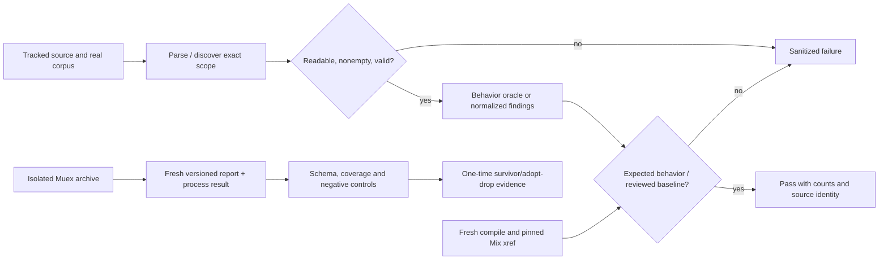

# Phase 196: Spec and structure ratchet - Research

**Researched:** 2026-10-27
**Domain:** ExUnit proof quality, scoped-observation privacy, policy diagnostics, Mix architecture, bounded workflow analysis, mutation-tool evaluation
**Confidence:** MEDIUM overall; direct repository observations are distinguished from external documentation and unmeasured execution outcomes below.

<user_constraints>
## User Constraints (from CONTEXT.md)

The following decisions, discretion and deferrals are copied verbatim. [VERIFIED: 196-CONTEXT.md:19-72,138-146]

<!-- DATA_a73d09e1_START -->
### Scope, sequencing and evidence authority

- **D-01:** Preserve all eight milestone requirements and GR-06. First harden evidence and boundary/policy specifications; then use those tests for the structural corrections and mutation pilot. The planner can interleave independent work, but the pilot measures the hardened tests. Preserve existing browser fixtures and native wire contracts.
- **D-02:** Measure new guards on actual `main` before promoting them into merge-blocking checks. Retain baseline findings and demonstrate each negative control. Promote deterministic recurring contracts through existing test/verification entry points; the Muex pilot stays one-time evidence. Report/advisory checks do not become required checks merely because this phase adds them. Record the tested commit and distinguish PR head from GitHub's synthetic merge commit.
- **D-03:** Copy a small, bounded check before adding a dependency. Use native Elixir AST/Mix facilities and existing test infrastructure. No committed Muex, property-testing, Bash-parser, graph, Credo or dialyzer dependency. The recorded overrun order remains SPEC-04, then ARCH-03, moved to v29 by an explicit roadmap change rather than weakened in place. A failed experiment is not permission to mark an unmet success criterion complete.

### Non-vacuous manifests and vector consumers — SPEC-01

- **D-04:** Separate unavailable optional evidence from a failed enabled proof. For the two named manifest tests, optional lanes may be visibly excluded/skipped when not requested. Once a lane or manifest input is supplied, assert prerequisites and validate the real generated manifest; missing, empty, malformed or wrong artifacts fail. Never use `assert true`, an empty `if File.exists?` body, or a fabricated fallback artifact as proof. Preserve committed-manifest coverage and the existing generated-manifest CI lane.
- **D-05:** Pin independently reviewed loaded and executed cardinalities in every existing vector-consuming test. A count computed from the same discovered collection is not an expectation. Scout values: request corpus 15 loaded; 9 Elixir executions and 14 Swift/Kotlin executions after the existing platform exclusions; reply-leg corpus 2. Reconfirm these values during planning before pinning. An intentional vector change updates expectations explicitly with its reason. Include other actual file consumers in the inventory, without claiming an inline native test consumes a JSON file that it never reads.
- **D-06:** Missing vector file, removed case, empty collection and exclusion of all cases must turn the relevant consumer red. Assert counts before loops and track actual executions after filtering. A platform exclusion is not a passing test of that platform's behavior. Phase 198 owns vector-set hashing and the generated parity ledger; this phase supplies trustworthy consumers, without duplicating that work.

### Delta-only absence guard — SPEC-02

- **D-07:** Extend `script/check_absence_is_not_success.exs` with native AST analysis of root and companion ExUnit files. Use a committed baseline of actual remaining unsafe findings after fixing the known sites in the same change. Identity is file + enclosing test/helper + normalized unsafe expression, with occurrence multiplicity; no line-number keys, blanket exemption for old tests, or added-lines-only diff. Deleting a cardinality guard can introduce a new unsafe finding without modifying the assertion line.
- **D-08:** Recognize the three scoped classes: collection-wide assertions without non-empty proof, `for` over glob-discovered files without cardinality, and literal `assert true`. Required non-empty proof must apply to the same collection in the same reachable lexical branch. Resolve simple module attributes before calling them non-empty; `[]` and arbitrary attributes are not evidence. Reuse the collection inventory selectively: its existing `compile_time_literal?/1` heuristic is unsafe to promote unchanged. Assertions intentionally specifying an empty result are legitimate and remain distinguishable from universal predicates over an empty collection.
- **D-09:** Fail on parse/read errors or an empty scan. New unsafe findings and increased occurrence counts fail; baseline removal is reviewable and stale entries are pruned explicitly. Do not auto-refresh the baseline to make CI green. Controls include deleting only the guard, guarding a different collection, guarding only another branch, duplicating an exempt finding, an empty module attribute, and literal `assert true`. Keep analysis bounded; do not build a general interprocedural verifier.

### Privacy boundaries and policy oracle — SPEC-03, SPEC-05

- **D-10:** Use explicit boundary tables first. `Journal.scope_ref!/1` lengths 15/16/128/129 refer to the opaque suffix after `v1.`. Test LF/CRLF and prefix/suffix injection, nonbinary inputs and exact constant error text. The scope value must never appear in errors, inspection, logs or proof output. Use synthetic values only.
- **D-11:** For every `SafeObservation` field and measurement key, test valid closed values, synthetic adversarial strings, and measurements 0, 1_000_000 and 1_000_001. Exercise constructor output and telemetry/logger/doctor projections, including forged structs where projections accept them. Do not consider constructor rejection sufficient evidence that projections cannot leak. The scout directly reproduced a route ID ending in LF surviving `new/1` and `to_telemetry/1`; fix that demonstrated boundary with absolute anchors while preserving the intended accepted domain. A small seeded loop may supplement a demonstrated gap; it does not replace explicit cases or justify `stream_data` here.
- **D-12:** Exhaust the bounded policy product: runtime 3 × offline 3 × entry 2 × security omitted/standard/sensitive 3 × sync absent/present 2 = 108 unique cases. Use a hand-written factored verdict table: explicit runtime/offline cells plus independent entry/security/sync rules. Expected verdicts must not call production validators or be generated by observing current compiler output. Pin both the unique-case count and executions, and compare exact sorted `{key, route_id}` errors. Keep malformed option types and `Route.new/1` short-circuit behavior in separate examples from the compiler's aggregate verdicts.
- **D-13:** Replace diagnostic-key inference from English error messages with structured NimbleOptions keys and explicit normalization. Preserve atom keys; split grouped unknown-option keys into per-key diagnostics rather than silently widening `Policy.Error.key` to lists or collapsing distinct keys into a new generic taxonomy. Missing route ID remains `{:id, nil}`; do not fabricate a route identity. `Compiler.validation_key/1` must never produce a nil key for a compiler error. Test mixed batches with an invalid route preceding valid/duplicate routes: the compressed-route indexing and zip are a source-attribution risk to reproduce and correct if confirmed. Controls mutate an allowed/denied policy verdict, remove required security, and corrupt a diagnostic key or route attribution.

### Compile structure and explicit exception boundaries — ARCH-01, ARCH-02

- **D-14:** Break the denial-family cycle through one tiny dependency-free protocol-version leaf. Keep `Bridge.Contract.version/0` as the existing API delegating to the leaf; let `Manifest.Types` obtain its default from that leaf. Preserve the existing version and exact wire representation. This removes the coupling without moving denial structs/serializers or hiding the edge by changing only its compile/runtime label. No broader module split.
- **D-15:** Use the pinned Mix xref implementation's own exit thresholds, including `--fail-above`, rather than another SCC implementation or a human-output parser. Fresh-compile before collecting graph evidence. Require zero compile-label/compile-connected cycles and a committed maximum for all cycles measured after the repair. The read-only scout on Elixir 1.19.5 saw one compile-connected cycle and four total SCCs, superseding the earlier report's three; these are scouting observations, not the committed repaired baseline. Do not use `--only-direct`, which can remove relevant mixed-label edges. Check compilation/source coverage separately so a missing/stale manifest cannot impersonate an acyclic graph. Controls must exercise a real mixed-label cycle, threshold overflow and missing compilation evidence using the dependency's real output.
- **D-16:** The three bare rescues in `bridge.ex` serve advisory router-location diagnostics. Use explicit internal `{:ok, value}` / `{:error, closed_reason}` outcomes, nonexceptional filesystem reads and finite expected exception handling. Preserve the original authoring error, denial and diagnostic fallback; do not turn a missing location hint into a new public failure or echo raw exception data.
- **D-17:** Scan each of the named root modules and descendants: bridge, policy, router, offline, manifest and compatibility. The AST guard must reject a broad rescue renamed from `_` to a variable as well. Two existing arbitrary companion/host extension boundaries in `compatibility/route_gate.ex` need intentional broad containment to remain fail-closed. Preserve their existing `:dependency_missing` / `:adapter_unloadable` denials and catch behavior through explicit sanitized outcomes and two reviewed semantic exception records, keyed by file + module/function + normalized clause/call target. No wildcard rescue remains; named whole-exception boundaries outside those exact sites fail. Missing, stale or duplicated exception records fail. Controls raise an arbitrary custom exception, verify no authorization success or raw exception telemetry, and introduce a renamed broad rescue outside the allowed sites. Narrowing extension containment to a few familiar exception classes would weaken the current boundary.

### Runtime dependency surface — ARCH-03

- **D-18:** Ratchet evaluated declared production runtime direct dependencies across the six Mix projects: core and five companions, matching the original Mix-focused architecture proposal. Include optional declarations as dependency surface; exclude dependencies unavailable in `:prod` and those with `runtime: false`. Record optionality and a nonblank one-line purpose for every entry. Compare names/classification, not lockfile versions, fetched transitive graphs or path spelling. Check both local and `CROSSWAKE_RELEASE=1` declaration branches without fetching dependencies.
- **D-19:** Discover and assert the non-empty exact project roster as well as each dependency set. Evaluate projects sequentially in isolated processes/Mix contexts; avoid VM-global cwd races. Additions, removals and classification changes require deliberate baseline edits; no automatic acceptance. Controls include a new optional runtime dependency, dev/test-to-prod promotion, `runtime: false` change, missing project and missing justification. Native dependency choices remain with Phase 198's Android JSON-stack decision and v29's toolchain work; do not silently broaden this Mix ratchet into new multi-ecosystem tooling.

### Throwaway Muex pilot — SPEC-04

- **D-20:** Freeze the evaluation protocol before observing results. Pin the inspected Muex 0.12.0 in task-specific `MIX_HOME` / `MIX_ARCHIVES`; try its isolated archive path first. A pinned locally built escript is a fallback only after an observed archive-integration failure and must pass the same controls. Use the one main checkout as the target; temporary tool-install scratch is not candidate state. Record target commit/tree cleanliness, tool/toolchain provenance, exact file and test selection, commands, runtime and output identity. Do not modify or commit project `mix.exs` / `mix.lock` for the pilot.
- **D-21:** Cover all four required groups through five explicit files: `SafeObservation`, `Journal`, `Policy.Compiler`, `Policy.Route`, `Bridge.Contract`. The inspected configuration uses a comma-separated `--files` value. Initial baseline uses `--no-filter --no-optimize --concurrency 1 --timeout 10000 --fail-at 0 --format json --output <fresh-attempt-path>`, subject to a real preflight confirming the pinned executable accepts it. No `--since`, sampling, coverage-guided selection or mutation cap masquerading as a full baseline. Verify selected tests actually execute with a relevant known-kill control; a populated `test_files` list alone is insufficient.
- **D-22:** Validate the actual versioned report schema. It has `summary.total`, six outcome counts (`killed`, `survived`, `invalid`, `timeout`, `equivalent`, `no_coverage`), score bounds and mutation records; no `mutations_generated` field exists. Require total = record count = sum of outcome counts, known statuses, allowed paths and at least one killed/survived result per selected file. Reject missing/stale/malformed reports, empty output, mismatched totals, nonzero process failure and timeout. The zero-mutant path may emit no report at all. Invalid compilation, uncovered cases, equivalent classifications and timeouts are not behavioral kills. Keep these categories visible instead of inflating a single score.
- **D-23:** Record per-file baseline score bounds, runtime and all survivors keyed by file + mutator + normalized before/after text, with a collision discriminator if needed. Classify survivors once as missing behavioral assertion, equivalent, or tool/infrastructure noise. Use known-kill and deliberately weakened-test known-survive controls, plus zero/missing/malformed/inconsistent report, timeout, invalid-only and no-tests controls. Fixtures/adapters must come from the tool's real output.
- **D-24:** Adopt only for later local advisory use if the controls discriminate, every target has useful executed mutants, survivors are classified, no timeout/infrastructure problem remains unresolved, and the prospective operational appetite holds: at most 30 minutes aggregate pilot wall time on the recorded machine, and invalid + uncovered outcomes at most 20% of non-equivalent emitted mutants. These are chosen project appetite limits, not external best-practice claims or measured results. Exceeding them favors drop for this slice. A score threshold is not an adoption gate. An incomplete/zero-target run cannot satisfy required coverage by calling it a drop; keep the requirement pending or apply the recorded overrun change. No weekly/PR mutation lane, committed tool dependency or bespoke harness follows automatically from either verdict.

### GR-06 bounded workflow grammar closure

- **D-25:** Close the accepted preventive grammar gap in `test/js/ci_secret_masking.test.mjs`, using a documented bounded convention and dependency-free analysis. The prior census found zero live secret-referencing instances in the seven missing forms; do not describe this debt as a reproduced current CI leak. Preserve the Phase 195 supported-mask and workflow-inventory contracts.
- **D-26:** Canonical scalar plain/export assignments with an exact unconditional stdout mask before any use remain supported. Explicitly deny credential-connected declaration (`local`/`declare`/`readonly`), append, `read`, `printf -v`, inline/multiple assignments and same-line early use unless an individual form is intentionally supported and execution-tested. Deny secret-connected persistence to `GITHUB_ENV` / `GITHUB_OUTPUT` as Crosswake's local convention, avoiding cross-step taint analysis. GitHub permits masked same-job outputs; do not invent a platform prohibition. Ordinary nonsecret metadata writes remain valid.
- **D-27:** Classify relevant statements in real run blocks, including inline and folded/block YAML forms. Unsupported credential-related shell/YAML constructs must produce an explicit sanitized finding, not zero candidates. Report file + statement category without values. Fresh census asserts a non-empty workflow/ref inventory and accounts for candidates as supported + denied + unknown; live denied and unknown counts must be zero. Derive counts from the tree rather than pinning today's totals. Inject every previously invisible family, multiple assignments with the secret in a later assignment, and use-before-mask on the assignment line. Execute synthetic controls to prove expansion, stdout registration and ordering; parser acceptance alone is not evidence of masking. Keep the existing bounded derived-secret definition; no arbitrary Bash/secret completeness claim.

### Agent discretion

The planner chooses file organization, minimal AST helpers, focused test grouping, sequential waves and PR boundaries within this scope. Preserve exact required outcomes and the measured-main promotion rule. Continue ordinary local work without per-step permission. Every main merge, publish, tag and remote-branch deletion still requires its own displayed one-use gate. This discussion grants none of those operations.

## Deferred Ideas

- Weekly/PR Muex lanes and score ratchets — maintainer; trigger: adopted pilot plus four-week stable advisory baseline; receiver: rolling-roadmap LATER mutation work.
- Property-testing dependency or broader seeded generation — maintainer; trigger: actual pilot survivors demonstrate boundary gaps a small deterministic corpus cannot reasonably cover; receiver: rolling-roadmap LATER property tests.
- General Bash parser/dataflow engine — maintainer; trigger: a fresh workflow census demonstrates necessary secret-connected syntax that bounded conventions cannot express; receiver: later scoped security-tooling proposal, not an implicit GR-06 expansion.
- Swift/Gradle dependency ratchets and Android JSON/toolchain choices — native maintainer; trigger: Phase 198 JSON-stack review or v29 toolchain PR; receivers: Phase 198 and v29. The six-Mix-project baseline does not claim native dependency coverage.
- Broader module splits, package/tarball layering and native mutation tools — maintainer; existing rolling-roadmap triggers and receivers remain unchanged.
- Original clean-room WR-04/05/06 and IN-03 — Phase 197 receiver unchanged; no reopened Phase 195 delivery, twin run or release action.
<!-- DATA_a73d09e1_END -->
</user_constraints>

## Summary

Implement a small group of behavior specs and bounded AST/Mix checks using the existing infrastructure. Research reconfirmed the three primary request-consumer cardinalities: 15 loaded, with 9 Elixir and 14 Swift/Kotlin eligible executions; reply-leg corpus 2. These are corpus/filter measurements, not newly implemented execution counters. The existing optional-manifest tautologies and unsafe collection heuristic remain in source. [VERIFIED: test/crosswake/bridge/bridge_behavioral_vector_test.exs:61-87; packages/crosswake-shell-core-ios/Tests/CrosswakeShellCoreTests/BridgeConformanceTests.swift:211-245; packages/crosswake-shell-core-android/src/test/java/dev/crosswake/shell/core/BridgeConformanceTest.kt:157-167; tool probe 2026-10-27; quoted exclusion values: `vector["native_only"] == true`, `vector.elixirOnly == true`, `vector.optBoolean("elixir_only", false)`]

Bounded research reproduced the trailing-LF observation defect and compiler source-provenance defect; fresh compilation reproduced one compile-connected cycle and four total cycles. The isolated Muex archive accepts the locked arguments, but the full five-file pilot, useful-mutant coverage, survivor classifications and repaired cycle baseline remain unmeasured. No product fixes, requirement changes, commits, branch changes, pushes or full pilot occurred. [VERIFIED: session probes recorded under Code Examples; lib/crosswake/offline/safe_observation.ex:94-97,54-65; lib/crosswake/policy/compiler.ex:32-46,107-125]

**Primary recommendation:** plan evidence/spec hardening first, then minimal corrections and structural ratchets, then the bounded five-file pilot; only promote recurring guards after actual-main measurements and discriminating controls. [VERIFIED: 196-CONTEXT.md:21-23,58-62; verbatim decisions above]

## Architectural Responsibility Map

| Capability | Primary tier | Secondary tier | Planning ownership and rationale |
|---|---|---|---|
| Scope grammar and safe observation projections | API/backend | Host storage/auth | Extend existing pure Elixir boundaries; host retains account mapping and replay authorization. [VERIFIED: lib/crosswake/offline/journal.ex:98-108; lib/crosswake/offline/safe_observation.ex:28-86; .planning/ADR-FIRST-B2C-ADOPTER.md:228-231] |
| Policy oracle and error provenance | Compile-time backend authoring | ExUnit | Keep normalized policy paired with its original source throughout normalization. [VERIFIED: lib/crosswake/policy/compiler.ex:32-46,107-125; lib/crosswake/policy/validator.ex:43-50] |
| Loaded/executed vector cardinality | Existing platform test consumer | Generator contract | Pin facts where loops execute; retain generator as corpus owner. [VERIFIED: lib/mix/tasks/crosswake.contract.gen.ex:80-95; primary-consumer citations above] |
| Absence/rescue/dependency/xref checks | Repository tooling | Existing ExUnit/CI entry points | Keep deterministic checks dependency-free and fixture-injectable. [VERIFIED: 196-CONTEXT.md:23,33-35,47-54; verbatim above] |
| Derived-secret grammar | Existing Node proof test | Workflow conventions | Extend one analyzer and its executed synthetic controls. [VERIFIED: test/js/ci_secret_masking.test.mjs:1063-1175,1296-1311] |
| Mutation evaluation | One-time local tooling | Hardened ExUnit | Tool installation scratch only; main checkout is target, retained evidence privacy-safe. [VERIFIED: 196-CONTEXT.md:58-62; verbatim above] |

## Project Constraints (from AGENTS.md)

All actionable directives relevant to planning are retained here; the full guide remains governing. [VERIFIED: AGENTS.md:5-102]

- Read the four governing files in prescribed order; resolve this workstream explicitly with `--ws quality-ratchet-release`; never infer a flat state. Preserve one active handoff and use exact eligible command/state; do not repeat completed Phase 195. [VERIFIED: AGENTS.md:5-13,63-78; workstream STATE.md:27-35]
- Preserve Phoenix-first per-route ownership, bounded typed/versioned low-frequency bridges, backend authority, fail-closed denials and honest offline claims. Keep Android proof/parity at its evidence ceiling and never delay an iOS gate beyond the re-freeze trigger. Respect stop-list reversal conditions. [VERIFIED: AGENTS.md:25-40]
- Use only the durable codename/public generic wording. Never identify or research the adopter; never put raw mutation/media/transcript/credential/account/token/device values in diagnostics or evidence. Preserve opaque scope partitioning and fail-closed logout/account switching. [VERIFIED: AGENTS.md:48-59]
- Automate all automatable verification; no human-verification checkpoint for scanner tests, tool output, native counts or pilot assessment. Human gates remain only unavoidable credentials, external approvals or irreversible trust actions. Promote only stable recurring contracts; keep one-time reconciliation in phase evidence. [VERIFIED: AGENTS.md:64-71]
- Reconcile requirements, roadmap, state, ADR/support truth and generated guides together if a decision changes; keep fast-changing adopter execution in codename-only drafts. Retire superseded routes explicitly as not executed; test adapters against real dependency output; privileged CLI access does not prove workflow access. [VERIFIED: AGENTS.md:70-84]
- Continue authorized reversible local work. A new main/release merge, publish, tag, or remote branch deletion requires a just-displayed, scoped, one-use gate; approvals never transfer. Preserve source checkout/branch for this research per orchestrator. Future product changes branch from current origin/main, go through PR and green head CI, merge commit only; report actual CI SHA separately from synthetic merge SHA. [VERIFIED: AGENTS.md:41-45,79-81,88-102]
- Run privacy scan before every push and after every new commit; fix observed CI causes forward; read and reconcile any uncertain write before retry. This research performs no push or commit. [VERIFIED: AGENTS.md:100-102; orchestrator scope]

<phase_requirements>
## Phase Requirements

Descriptions below are copied from the active requirement owner; the quoted IDs are `SPEC-01`, `SPEC-02`, `SPEC-03`, `SPEC-04`, `SPEC-05`, `ARCH-01`, `ARCH-02`, `ARCH-03`. [VERIFIED: ../../REQUIREMENTS.md:41-51]

| ID | Description | Research support |
|---|---|---|
| SPEC-01 | `evidence_manifest_test.exs:98` and `phase139_threadline_cleanroom_test.exs:59` no longer pass by asserting nothing; Elixir, Swift and Kotlin vector-consuming tests assert vector count equals a pinned expectation and fail on a missing vector. | Optional-lane split; consumer inventory and controls below. |
| SPEC-02 | A delta-only guard in `script/check_absence_is_not_success.exs` fails on new collection assertions without a non-empty check, `for`-over-glob without cardinality, and literal `assert true`, each with a negative control; the known sites are fixed in the same change. | Branch-aware AST analysis and multiset baseline. |
| SPEC-03 | Boundary specs exist for `Journal.scope_ref!/1` (15/16/128/129 chars, newline injection, input never echoed) and `SafeObservation.new/1` (measurement 0, 1_000_000, 1_000_001; adversarial strings in every field never survive). | Closed vocabulary, projection test matrix, reproduced LF gap. |
| SPEC-04 | A Muex pilot covers `SafeObservation`, `Journal`, `Policy.Compiler`/`Route` and `Bridge.Contract`; the wrapper fails if zero mutants are generated; baseline scores, runtime and survivor classification (keyed by file + mutator + normalized text) are recorded with an adopt/drop decision; no Muex dep is committed. | Pinned archive preflight, report schema and execution protocol. |
| SPEC-05 | The finite route-policy option product is enumerated exhaustively against a hand-written verdict table; compiler error assertions pin `{key, route_id}` pairs; `Compiler.validation_key/1` never returns `nil` for a compiler error. | Independent factored oracle and structured-error/source-pair correction. |
| ARCH-01 | The `bridge/contract`, `bridge/denial`, `manifest/types`, `shell/denial` compile cycle is broken; a test fails on any compile-label xref cycle and on an all-cycles count above the committed baseline. | Version leaf; built-in thresholds plus fresh manifest coverage. |
| ARCH-02 | The three bare `rescue _ ->` clauses in `bridge.ex` return explicit results; an AST test fails on bare rescue in the `bridge`, `policy`, `router`, `offline`, `manifest` and `compatibility` modules. | Three advisory helpers and two exact broad-boundary exceptions. |
| ARCH-03 | A test compares each package's runtime direct deps to a committed list; adding a dep requires editing the list with a one-line justification. | Six-project evaluated dependency roster in both declaration modes. |

GR-06 is an accepted carried receiver rather than a ninth milestone requirement; D-25..27 govern it. [VERIFIED: 196-CONTEXT.md:64-68; verbatim above]
</phase_requirements>

## Standard Stack

Use the installed/pinned stack; no production dependency upgrade belongs in this phase. Package versions below identify observed tools/dependencies, not recommendations to upgrade to latest. [VERIFIED: 196-CONTEXT.md:23,58-62; verbatim above]

| Component | Observed version | Purpose / evidence |
|---|---|---|
| Elixir / Mix | 1.19.5 / OTP 27 | AST parsing, isolated declaration evaluation, xref; local version probes and CI tool pin agree. [VERIFIED: session `elixir --version`, `mix --version`; .github/workflows/crosswake-ci.yml:1096; value `elixir-version: "1.19.5"`] |
| ExUnit / native AST / Mix | Bundled with pinned Elixir | Existing tests and `Code.string_to_quoted/2`; existing guard patterns use native traversal. [VERIFIED: test/test_helper.exs:1; lib/crosswake/component_tier_guard.ex:84-88] |
| NimbleOptions | 1.1.1 installed | Structured diagnostic provenance. Quote: `key: atom()`, `keys_path: [atom()]`, `defexception [:message, :key, :value, keys_path: []]`. [VERIFIED: deps/nimble_options/lib/nimble_options/validation_error.ex:11-31] |
| Jason | 1.4.5 locked | Existing JSON decode/report handling. Quote: `"jason": {:hex, :jason, "1.4.5"`. [VERIFIED: mix.lock:7] |
| Node | 22.14.0 local | Existing dependency-free `node:test` workflow grammar tests; no YAML/Bash dependency. [VERIFIED: session `node --version`; test/js/ci_secret_masking.test.mjs:1-9; quote `import { test } from "node:test";`] |
| Swift / JDK | Swift 6.3.3; OpenJDK 17.0.19 available explicitly | Native verification uses existing SPM/Gradle tests. Default `java` is an unconfigured macOS launcher; explicit Homebrew JDK works. [VERIFIED: session version probes; .github/actions/setup-android-jvm/action.yml:8-10; value `default: "17"`] |
| Muex | 0.12.0, Hex release 2026-10-21 | Temporary archive only. Registry response and pinned source agree; unversioned docs returned older 0.11.x pages, so use pinned source. [CITED: https://hex.pm/api/packages/muex/releases/0.12.0] [CITED: https://github.com/Oeditus/muex/blob/v0.12.0/mix.exs] |

### Package Legitimacy Audit

The only new tool installation is isolated Muex, officially linked by the Hex registry to its source repository. Registry probe observed latest 0.12.0, first package publication 2026-01-18, 23,937 lifetime / 3,225 weekly downloads, MIT licensing, and source repository. These are dated registry observations, not a supply-chain guarantee. [CITED: https://hex.pm/api/packages/muex]

| Package | Registry | Age at research | Downloads | Source | Seam verdict | Disposition |
|---|---|---|---|---|---|---|
| muex 0.12.0 | Hex | About nine months | 3,225/week observed | github.com/Oeditus/muex | Unsupported ecosystem | Official source + Hex tarball inspected; isolated archive preflight passed; no committed dependency. |

The required seam was attempted exactly with `query package-legitimacy check --ecosystem hex muex`; it returned usage restricted to `npm|pypi|crates`. Do not report an invented OK/SUS verdict or perform an npm lookup of a Hex name. No SLOP package was recommended; no suspicion checkpoint is justified by an unsupported seam. Existing dependency names are verified from repository declarations, not newly discovered install recommendations. [VERIFIED: session seam output; $HOME/.codex/gsd-core/bin/gsd-tools.cjs:4308-4319; quoted ecosystem values `npm|pypi|crates`]

## Architecture Patterns

### System Architecture Diagram

This is the prescribed data flow, not an additional framework. [VERIFIED: 196-CONTEXT.md:21-35,47-68; verbatim above]



### Component Responsibilities and Recommended Structure

Use existing owners and add focused test modules rather than a general quality framework. Proposed new filenames are planning suggestions, not claims that files already exist. [VERIFIED: 196-CONTEXT.md:70-72; discretion copied above]

| Responsibility | Existing owner / proposed addition |
|---|---|
| Optional artifact enabled/disabled behavior | Existing evidence manifest and Threadline clean-room test files. |
| Collection analysis | Extend existing absence script and guard tests; one small AST helper if needed; committed residual baseline under script-owned fixtures. |
| Privacy boundary tables | Extend existing Journal and SafeObservation test modules. |
| Exhaustive oracle / diagnostic correction | Existing policy tests plus proposed `test/crosswake/policy/finite_product_test.exs`. |
| Compile / rescue / deps ratchets | Proposed `test/crosswake/proof/architecture_ratchet_test.exs` and small script helpers/baselines; no runtime framework dependency. |
| GR-06 grammar | Existing `test/js/ci_secret_masking.test.mjs`; preserve its supported mask tests. |
| One-time pilot | Phase evidence wrapper/protocol only; install tool outside repository. |

### Pattern 1: optional proof is visibly unavailable or strictly enabled

The committed example manifest already has independent coverage. The generated branch currently quotes `nil -> assert true`, while Threadline's canary checks `Code.ensure_loaded?(Plug.Conn)` and otherwise asserts true. Root test configuration already builds one merged exclusion list; Threadline starts with exclusions for example-host/advisory tests. Use compile-time tags/exclusion derived from request state, with enabled-lane assertions; a missing supplied manifest path must never become the optional path. Keep committed-example validation separate. [VERIFIED: test/crosswake/guides/evidence_manifest_test.exs:82-104; packages/crosswake_threadline/test/crosswake/proof/phase139_threadline_cleanroom_test.exs:46-59; test/test_helper.exs:13-59; packages/crosswake_threadline/test/test_helper.exs:1]

The generated-manifest CI step supplies `CROSSWAKE_EVIDENCE_MANIFEST_PATH=examples/phoenix_host/playwright-artifacts/route-tour/evidence-manifest.json` and runs the named suite. Preserve this real producer/consumer lane; do not substitute committed-example fixture artifacts for generated output. [VERIFIED: .github/workflows/crosswake-ci.yml:1463-1466; quoted invocation at line 1466]

### Pattern 2: inventory actual readers, then pin loaded and executed populations

The canonical bridge corpus is generated into three locations; it is not located under the navigation-only directory named in some broad roadmap prose. Creator quotes: `@vectors_path "test/fixtures/bridge_contract_vectors.json"`, `@ios_vectors_path "packages/crosswake-shell-core-ios/Tests/CrosswakeShellCoreTests/Resources/bridge_contract_vectors.json"`, `@android_vectors_path "packages/crosswake-shell-core-android/src/test/resources/bridge_contract_vectors.json"`; generator calls `write_if_changed` for each. [VERIFIED: lib/mix/tasks/crosswake.contract.gen.ex:52-54,83-95]

| Actual reader | Reads / behavior | Planning pin |
|---|---|---|
| Elixir BridgeBehavioralVectorTest | `@vectors Jason.decode!(File.read!(@vectors_path))`; skips `native_only` | 15 loaded / 9 executed. [VERIFIED: test/crosswake/bridge/bridge_behavioral_vector_test.exs:61-87; session corpus probe] |
| Swift BridgeConformanceTests | Decodes `BridgeVectorsFile`; skips `elixirOnly` | 15 loaded / 14 executed. [VERIFIED: packages/crosswake-shell-core-ios/Tests/CrosswakeShellCoreTests/BridgeConformanceTests.swift:127-131,211-245; session corpus probe] |
| Kotlin BridgeConformanceTest | Reads `vectors`; skips `elixir_only` | 15 loaded / 14 executed. [VERIFIED: packages/crosswake-shell-core-android/src/test/java/dev/crosswake/shell/core/BridgeConformanceTest.kt:16-19,157-167; session corpus probe] |
| Swift / Kotlin BridgeReplyLeg tests | `reply_leg_vectors`; Swift iterates landing-pad cases, Kotlin finds two IDs | 2 loaded; count real per-case work, not total test invocations. [VERIFIED: packages/crosswake-shell-core-ios/Tests/CrosswakeShellCoreTests/BridgeReplyLegTests.swift:43-59,82-91; packages/crosswake-shell-core-android/src/test/java/dev/crosswake/shell/core/BridgeReplyLegTest.kt:36-42,85-95; quoted field `reply_leg_vectors`] |
| Swift ActivationConformance, OfflineIslandAdmission, Phase180TwinFeasibility; Kotlin ActivationConformance | Read `bridge_protocol_version` metadata, then execute separately authored cases | Assert shared corpus loaded count at read boundary; label corpus-case executions as not applicable. Never claim 14 JSON verdicts executed here. [VERIFIED: corresponding Swift files:14-20,12-17,52-55; packages/crosswake-shell-core-android/src/test/java/dev/crosswake/shell/core/ActivationConformanceTest.kt:18-23; quoted field `bridge_protocol_version`] |
| Swift NavigationCoordinatorTests | Separate topology file, selects `synthetic_authorized_root` | 5 loaded / 1 selected JSON case; other tests are inline. [VERIFIED: packages/crosswake-shell-core-ios/Tests/CrosswakeShellCoreTests/NavigationCoordinatorTests.swift:38-48; priv/contract_vectors/navigation_topology_vectors.json:4-9; quote `synthetic_authorized_root`, `empty_inventory`, `invalid_parent`, `incompatible_manifest`, `authorization_denial`] |
| ContractDriftTest / generated-surface and publish-readiness tests | File/version/integrity or existence consumers | Inventory as structural readers, not behavioral corpus executions. [VERIFIED: test/crosswake/contract/contract_drift_test.exs:35-64; lib/crosswake/doctor/publish_readiness.ex:636] |

The navigation-transition JSON is an advisory evidence input; source search did not show a native test reading it. Do not claim a native consumer from filename proximity. Preserve Phase 198 ownership of hashing/parity inventory. [VERIFIED: lib/crosswake/proof_lane/navigation_shell_advisory.ex:23-25; 196-CONTEXT.md:29; quote `"transition_vectors"`, `"topology_vectors"`]

For each real loop, assert independently reviewed loaded cardinality before filtering, and collect an execution result per admitted case after its assertions. Pin execution results afterward. A local `count = length(discovered)` compared to the same length proves nothing. Mutation controls remove a file, one vector, every vector, and all eligible cases; restore source/corpus in an `after`/cleanup boundary and assert the mutation actually changed input. [VERIFIED: 196-CONTEXT.md:28-29; verbatim above]

### Pattern 3: AST findings as a residual multiset

The existing absence check has root-test floor 253 and a separate independent walk; research run scanned 259 root files. Its current checks are mutation-helper correctness and citation resolution, not the three new collection rules. Extend its scope explicitly to companion ExUnit files with independent roster/completeness checks. [VERIFIED: script/check_absence_is_not_success.exs:64-99,135-157; quote `{"test-files", "test/**/*.exs", 253}`; session execution]

The collection inventory is largely lexical, despite AST reuse language in context: it strips heredocs, divides text into test blocks, finds call text and uses regex heuristics. Reuse normalization/ordinal concepts, not the safety classifier. Its quote `Regex.match?(~r/^@[a-zA-Z_]\w*$/, trimmed)` treats any attribute as fixed nonempty evidence; `[]` also satisfies its bracket shape. [VERIFIED: script/inventory_collection_assertions.exs:238-283,286-303,580-591]

Recommended bounded implementation: parse source with native AST, walk modules/test/helper bodies with lexical branch environments, normalize expressions without metadata, and track positive-cardinality facts tied to the exact resulting collection. Invalidation on rebinding and branch-local guards is necessary; proving a source list nonempty does not prove its filtered derivative nonempty. Recognize positive list patterns/counts, concrete nonempty literals and resolvable simple attributes; treat unknowns conservatively. Strings/sigils/quoted fixture code remain data. Exact-empty expectations and inherently non-vacuous positive existential assertions are legitimate. [VERIFIED: 196-CONTEXT.md:33-35; native guard precedent lib/crosswake/component_tier_guard.ex:84-88]

Compare actual unsafe findings against a reviewed multiset keyed by file/enclosing context/normalized expression, counting repeats. Fail on new or increased counts and stale baseline entries; no implicit refresh. Deleting only a same-branch cardinality assertion must change the computed finding set. Fix the two tautologies and known glob loops in the same change; remeasure current sites, since earlier line references have shifted. [VERIFIED: 196-CONTEXT.md:33-35; test/crosswake/proof/phase132_compat_matrix_drift_test.exs:162-178; test/crosswake/proof/phase165_ci_integrity_test.exs:810-822]

### Pattern 4: privacy boundary tables and independent policy oracle

Journal's exact grammar/error are quoted here: `~r/\Av[1-9][0-9]*\.[A-Za-z0-9_-]{16,128}\z/`, `"CW-OFFLINE-SCOPE-REF"`; invalid binary and nonbinary values raise the same constant message. The suffix length is the bounded component. Do not introduce an inspection assertion that forbids the legitimate scope field on Journal.Entry itself: the privacy contract forbids exporting sensitive journal data to diagnostics, and this phase specifically proves rejected-input errors/projections, not removal of payload from the domain object. [VERIFIED: lib/crosswake/offline/journal.ex:53-54,98-108,22-33,81-95; .planning/ADR-FIRST-B2C-ADOPTER.md:228-231]

SafeObservation vocabulary, quoted verbatim for table-driven specs: `[:route_id, :runtime, :lifecycle, :outcome, :denial, :measurements]`, `[:configuration, :adapter_readiness]`, `[:offline_island]`, `[:started, :replayed, :stopped, :blocked]`, `[:accepted, :rejected, :conflict, :blocked]`, `[:none, :scope_inactive, :sigra_denied, :route_denied, :feature_denied]`, `[:attempt_count, :event_count, :duration_ms]`, `[:configured, :unconfigured, :ready, :blocked, :unavailable]`; measurements require integers from `0` through `1_000_000`. Quote current defective route regex: `~r/^route-[0-9a-f]{16}$/`. [VERIFIED: lib/crosswake/offline/safe_observation.ex:9-15,94-119]

Constructor and all projections revalidate forged structs, so test every field at both boundaries, unknown map/measurement keys, nested/noninteger values, and exact error projections; preserve legitimate empty measurements if accepted. Use `\A` and `\z` for the demonstrated route-boundary repair and explicit LF/CRLF/prefix/suffix cases. OTP 27 documentation confirms absolute-anchor semantics; do not rely on the newer PCRE2 change described in unversioned OTP 29 docs. [VERIFIED: lib/crosswake/offline/safe_observation.ex:45-86,106-116] [CITED: https://www.erlang.org/docs/27/apps/stdlib/re.html]

The policy domain is quoted from its owner: `[:live_view, :offline_island, :native_screen]`, `[:unavailable, :cached_read_only, :local_first]`, `[:internal_only, :external]`, `[:standard, :sensitive]`; omitted security is distinct from supplying a malformed value. Defaults quote `offline: :unavailable`, `entry: :internal_only`, `capabilities: []`, `packs: []`, `sync: []`. [VERIFIED: lib/crosswake/policy/schema.ex:16-19; lib/crosswake/policy/defaults.ex:6-12]

Use this explicit handwritten runtime/offline table, with entries denoting added diagnostic keys, and independently append entry/security/sync rules. It encodes current declared policy intent, not a table harvested from compiler outputs. [VERIFIED: lib/crosswake/policy/validator.ex:67-134,390-392; source clauses quoted values `:live_view`, `:local_first`, `:offline_island`, `:unavailable`, `:offline`, `:entry`, `:sync`, `:security`]

| Runtime | unavailable | cached_read_only | local_first |
|---|---|---|---|
| live_view | none | none | offline |
| offline_island | offline | none | none |
| native_screen | none | none | none |

- Entry adds `:entry` only for `:external` with `:offline_island`.
- Sync adds `:sync` only when the explicit sync list is nonempty and offline is `:unavailable`.
- Security adds `:security` only when omitted and offline is supported, entry is external or sync is nonempty; other dimensions in this bounded product remain empty/default.
- Pin uniqueness and total executions to 108. For complete semantic aggregation, exercise normalized routes directly through Validator against an independent factored expected-key set; separately run the compiler matrix with a handwritten normalization-stage rule. `Route.new/1` rejects external offline-island entry before Validator, so the compiler emits the early `:entry` error for those rows rather than every semantic error. Separate tests must pin that short-circuit and malformed types. Do not change production semantics just to force a flat oracle. [VERIFIED: lib/crosswake/policy/route.ex:77-85,235-247; lib/crosswake/policy/compiler.ex:90-104; lib/crosswake/policy/validator.ex:43-65; 196-CONTEXT.md:41]

NimbleOptions documents `:key`, `:keys_path`, `:value`. Installed 1.1.1 returns a list in `key` for grouped unknown options despite atom-only type prose. Research probes confirmed missing ID gives `:id`, invalid sync gives `:sync`, and two unknown options give `[:unknown_a, :unknown_b]`. Normalize each atom/list member into individual Policy.Error entries; retain nil route identity for absent ID. Source retains `key: atom() | nil`, so list widening is not an allowed shortcut. [VERIFIED: deps/nimble_options/lib/nimble_options/validation_error.ex:11-31; lib/crosswake/policy/error.ex:19-28; session probe, synthetic keys `:unknown_a`, `:unknown_b`] [CITED: https://hexdocs.pm/nimble_options/1.1.1/NimbleOptions.ValidationError.html]

Carry successful normalization as `{normalized_route, original_managed_route}` pairs. Derive duplicate and semantic errors from those pairs; never zip the compressed successful list against the unfiltered input. Research confirmed wrong path/line attribution after one invalid route, although route_id remained that of the normalized route. Test exact `{key, route_id}` and independently path/helper/verb/file/line for invalid-first, duplicate and mixed batches. [VERIFIED: lib/crosswake/policy/compiler.ex:32-46,107-125; lib/crosswake/policy/validator.ex:43-50,374-386; session reproduction below]

### Pattern 5: version leaf and real Mix exit semantics

The narrow compile-time seam is `@bridge_protocol_version Crosswake.Bridge.Contract.version()`; Contract currently quotes `@version "1.1.0"`, exposes `version/0`, and references denial/manifest types. Preserve `"1.1.0"` and existing API/wire serializers while introducing only a dependency-free leaf. Do not move the denial structs or serializers. [VERIFIED: lib/crosswake/manifest/types.ex:771-774; lib/crosswake/bridge/contract.ex:6-10,105-106; lib/crosswake/bridge/denial.ex:42-64; lib/crosswake/shell/denial.ex:12-36]

Use three separate commands after successful fresh compilation: compile-label threshold zero, compile-connected threshold zero, all-cycles threshold from measured repaired baseline. Mix 1.19.5 already raises/exits nonzero using `--fail-above`; both compile and compile-connected filters retain the relevant mixed-label cycle unless restricted to only-direct edges. Never replace this with output-count parsing. [CITED: https://mix.hexdocs.pm/1.19.5/Mix.Tasks.Xref.html] [CITED: https://github.com/elixir-lang/elixir/blob/v1.19.5/lib/mix/lib/mix/tasks/xref.ex]

Pinned Mix reads the compiler manifest as module/source maps. A bounded current probe used `Mix.Compilers.Elixir.read_manifest(Path.join(Mix.Project.manifest_path(), "compile.elixir"))`: 324 module records, 170 source records, 156 lib sources, exact equality to the independent lib source discovery. For the guard, assert nonempty expected modules/sources, existence and readable manifest, successful fresh compile, and exact intended source coverage. This internal API is pinned-version-sensitive: isolate it and test real malformed/missing-manifest output; a manually invented record tuple is not a dependency fixture. [VERIFIED: session manifest probe; pinned Mix xref source lines 884-885] [CITED: https://github.com/elixir-lang/elixir/blob/v1.19.5/lib/mix/lib/mix/tasks/xref.ex]

Research current graph, after `MIX_ENV=test mix compile --force --warnings-as-errors`: one mixed compile/export cycle in the four named modules; four total cycles including router/scope-defaults, evidence/native-promotion, builder/support-matrix. Both compile-label and compile-connected zero thresholds fail. These are current pre-repair observations, not the future committed maximum. [VERIFIED: session xref invocations/output below]

### Pattern 6: exact broad-boundary exception records

The three advisory helpers are quoted `find_router_route/2`, `router_source_file/1`, `best_effort_line_suffix/2`; each currently has `rescue _ ->` and diagnostic-only fallback. Replace filesystem raising reads with result reads, keep finite expected exceptions around reflection/router calls and map closed internal outcomes back to existing public diagnostic text. Protect original UndeclaredCapabilityError behavior when hints are unavailable. [VERIFIED: lib/crosswake/bridge.ex:599-623,666-710]

Exactly two semantic exception records are justified by existing extension boundaries, not by broad module permission: [VERIFIED: lib/crosswake/compatibility/route_gate.ex:138-167,263-323]

| File / module / function | Protected call and behavior | Guard record |
|---|---|---|
| compatibility/route_gate.ex / Crosswake.Compatibility.RouteGate / `check_dependencies/2` | Quote `companion.validate_dependency()`; broad rescue and existing catch map to `:adapter_unloadable`, then denial `:dependency_missing`; telemetry exports only `exception: true`. | Exact normalized clause/call target; preserve catch as well as arbitrary exception containment. [VERIFIED: lib/crosswake/compatibility/route_gate.ex:138-180] |
| compatibility/route_gate.ex / Crosswake.Compatibility.RouteGate / `prepend_auth_evaluation_denials/4` | Quote `authority.evaluate_auth(route, auth_context, opts)`; broad rescue yields `{:deny, Denial.new(...)}` with `reason: :dependency_missing`. | Exact normalized clause/call target; preserve current auth fail-closed behavior, without inventing catch behavior absent from this site. [VERIFIED: lib/crosswake/compatibility/route_gate.ex:263-323] |

Use named whole-exception clauses at only those sites with sanitized explicit result conversion; `_` renamed to an arbitrary variable remains broad and is rejected everywhere else. Scan actual roots plus descendants; some roots are directory-only, so fail if the overall family is empty without demanding nonexistent root files. Preserve finite rescues such as `error in [SyntaxError] -> reraise error, __STACKTRACE__` and `ArgumentError ->` in schema conversions. [VERIFIED: lib/crosswake/router.ex:158-162; lib/crosswake/policy/schema.ex:524-548; 196-CONTEXT.md:49]

### Pattern 7: declared production direct dependencies, not fetched graphs

Evaluate each mix.exs with Mix started in a fresh process and production environment, obtain evaluated project deps, normalize the three standard tuple forms, filter by production availability and runtime flag, include optional entries, and compare sorted names plus classifications/purpose. Research evaluated all six projects sequentially in both declaration branches without deps.get. Local/release normalized surfaces agree; root has five runtime deps. [VERIFIED: session 12-process probe; mix.exs:44-64] [CITED: https://mix.hexdocs.pm/1.19.5/Mix.Tasks.Deps.html]

| Project app | Production runtime direct set (optional marked) | Initial purpose text for deliberate baseline review |
|---|---|---|
| core | `:jason`, `:nimble_options`, `:phoenix`, `:phoenix_live_view`, `:telemetry` | JSON; declaration validation; routing/host integration; LiveView bridge; bounded operational events. [VERIFIED: mix.exs:52-63; verbatim dependency names] |
| rulestead companion | `:crosswake`, `:rulestead` (optional) | Core contracts; optional feature engine. [VERIFIED: packages/crosswake_rulestead/mix.exs:51-56,66-69; quote `optional: true`] |
| rindle companion | `:crosswake`, `:rindle` (optional) | Core contracts; optional media engine. [VERIFIED: packages/crosswake_rindle/mix.exs:62-71,81-84; quote `optional: true`] |
| sigra companion | `:crosswake` | Core auth contract integration. [VERIFIED: packages/crosswake_sigra/mix.exs:34-56; quote `{:crosswake, "~> 0.2"}` / `{:crosswake, path: "../.."}`] |
| chimeway companion | `:crosswake` | Core notification contract integration; `:crosswake_sigra` is `only: :test` and excluded. [VERIFIED: packages/crosswake_chimeway/mix.exs:34-64; quoted declaration `{:crosswake_sigra, path: "../../packages/crosswake_sigra", only: :test}`] |
| threadline companion | `:crosswake`, `:plug` (optional), `:phoenix_live_view` (optional), `:nimble_options`, `:telemetry` | Core contracts; optional Plug/LiveView surfaces; option validation; event observation. [VERIFIED: packages/crosswake_threadline/mix.exs:34-61; verbatim dependency names and `optional: true`] |

For discovery, independently enumerate the root project plus immediate companion project files, then assert exact roster membership and nonempty per-project declarations before filtering. Preserve empty filtered sets only if intentionally baselined, never because a child failed to load. Two-tuple path entries are option tuples, not requirements. Ignore version and path spelling in comparison. Nonblank purpose is required for each retained entry; classification changes must fail even if the name remains unchanged. [VERIFIED: 196-CONTEXT.md:53-54; verbatim above] [CITED: https://mix.hexdocs.pm/1.19.5/Mix.Tasks.Deps.html]

### Pattern 8: pilot protocol frozen before behavioral results

The archive installed successfully in isolated scratch. Important environment refinement: also set task-specific `HEX_HOME`; `MIX_HOME`/`MIX_ARCHIVES` alone caused an observed Hex cache write to the user's home to fail with `{:error, :eperm}`. Reading installed archive state showed only Hex before retry, and setting isolated HEX_HOME resolved installation without credentials. This was an install-environment issue, not evidence that archive mutation integration fails; the escript fallback is not triggered. [VERIFIED: session isolated install attempts and archive listing]

Pinned config parses comma-separated files and the exact locked flags. The root zero-source preflight returned exit 0 and `No mutations to test; nothing to score.` with no output report. That is a discriminating zero-input observation, not a five-file pilot. A direct call to the installed reporter also emitted its actual empty schema. The `mix run` task pruned the archive code path in one probe; direct `elixir -pa <archive-ebin> -pa <existing-jason-ebin>` successfully inspected config/reporter. Do not treat `mix run` API failure as a failed `mix muex` integration. [VERIFIED: session preflight/config/reporter probes] [CITED: https://github.com/Oeditus/muex/blob/v0.12.0/lib/muex/config.ex] [CITED: https://github.com/Oeditus/muex/blob/v0.12.0/lib/mix/tasks/muex.ex]

The JSON schema uses top-level summary/mutations, summary total plus six outcome counts and low/high bounds; mutation records have status, mutator, description, location file/line, patch before/after, duration, error and test_files. Empty/all-invalid reports cannot prove useful behavior. Patch may be null when AST metadata is absent: treat absent before/after for a survivor as an unresolved identity problem rather than silently hashing a line number. The reporter's denominator is killed + survived + timeout; compute operational noise independently as (invalid + no_coverage)/(total - equivalent), rejecting a zero denominator. [CITED: https://github.com/Oeditus/muex/blob/v0.12.0/lib/muex/reporter/json.ex] [CITED: https://github.com/Oeditus/muex/blob/v0.12.0/lib/muex/reporter/patch.ex]

Execution plan must first capture one real nonempty tool report and use it to seed adapter controls. Include known-kill and weakened-test survive checks that establish real selected-test execution; tool dependency selection and test_files metadata alone are insufficient. Then run all five explicit source files with no cap/sampling/changed-lines optimization, use hardened offline/policy/bridge test selections, retain per-file useful outcomes, classify every survivor once and enforce aggregate budget. A run that covers fewer targets remains incomplete regardless of adopt/drop wording. Research has not measured runtime, baseline scores, useful mutants or noise. [VERIFIED: 196-CONTEXT.md:58-62; verbatim above] [CITED: https://github.com/Oeditus/muex/blob/v0.12.0/lib/muex/test_runner/port.ex]

### Pattern 9: close GR-06 by complete bounded classification

Current grammar quotes `const ASSIGN = /^\s*(?:export\s+)?([A-Za-z_][A-Za-z0-9_]*)=(.*)$/;`; run-block discovery recognizes block/folded headers; use checking starts at `a.index + 1`. The current derived map lives across the workflow scan, so new classification should keep run-local state and avoid cross-step name contamination. Preserve the existing bounded one-level derivation/transitivity contract rather than widening to arbitrary taint inference. [VERIFIED: test/js/ci_secret_masking.test.mjs:1069,1092-1127,1163-1173]

Build a relevant-statement classifier ahead of support validation: discover all run blocks including inline/folded forms, collect direct credentials and secret-bound aliases, classify supported/denied/unknown, and only then apply exact stdout registration/order checks to supported scalar assignments. Explicitly reject the locked unsupported families, later-position secrets in multiple assignments and use on the assignment line. Unsupported credential-connected syntax must count as denied/unknown, never disappear. Ordinary GITHUB_OUTPUT metadata writes stay accepted. Keep findings to file and category; raw statement/RHS/derived values must not enter diagnostics. [VERIFIED: 196-CONTEXT.md:66-68; verbatim above]

GitHub documents a supported same-job masked output pattern; forbidding credential persistence here is project policy. Bash documents declaration assignments and append semantics; parser recognition alone cannot establish expansion or stdout delivery. Reuse spawned Bash controls and the existing runner-mask emulator, including wrong quoting, redirected stdout, skipped registration and same-line early-use controls. [CITED: https://docs.github.com/en/actions/reference/workflows-and-actions/workflow-commands] [CITED: https://www.gnu.org/software/bash/manual/html_node/Shell-Parameters.html] [VERIFIED: test/js/ci_secret_masking.test.mjs:1180-1196,1320-1343,1360-1406]

Research reran the current narrow-grammar suite: 11 selected tests pass; live census reports 94 references, 30 aliases, 2 derived assignments, 0 violations. These counts describe the existing detector, not the completed GR-06 classification or evidence that unsupported syntax is universally absent. The retained Phase 195 seven-form census is historical preventive-debt evidence. Recompute comprehensive counts during execution and require nonempty inventory plus supported + denied + unknown = candidates, with denied/unknown zero on the real tree. [VERIFIED: session Node test output; test/js/ci_secret_masking.test.mjs:1296-1311; 195-EVIDENCE/mask-gr-warn-control-195.txt]

## Don't Hand-Roll

| Problem | Do not build | Use instead / reason |
|---|---|---|
| Compile graph SCCs / exit parsing | New graph engine or regex count parser | Pinned Mix xref thresholds; source/manifest completeness checked separately. [CITED: https://mix.hexdocs.pm/1.19.5/Mix.Tasks.Xref.html] |
| Dependency inventory | Lockfile/tree/version text parser | Evaluated Mix project config in isolated child processes; ordinary tuple semantics. [CITED: https://mix.hexdocs.pm/1.19.5/Mix.Tasks.Deps.html] |
| Policy expected verdicts | Oracle that invokes production validators or learns outputs | Independent 9-cell table plus three rules. [VERIFIED: 196-CONTEXT.md:41; copied above] |
| Arbitrary Bash / secret dataflow | New general parser package or cross-step taint engine | Explicit bounded convention plus unknown/denied accounting and execution controls. [VERIFIED: 196-CONTEXT.md:66-68,143; copied above] |
| Mutation engine | In-repo AST mutation system or new CI lane | Isolated pinned Muex pilot and one-time report adapter; no automatic follow-on. [VERIFIED: 196-CONTEXT.md:23,58-62; copied above] |

## Runtime State Inventory

This phase contains narrow internal refactoring, so all five categories are accounted for. No string rename, storage format migration or external-state mutation is planned. The inventory is scoped to changed seams and declarations; this is not an audit of user accounts or external service inventories. [VERIFIED: 196-CONTEXT.md:46-54; copied above]

| Category | Findings / evidence | Required action |
|---|---|---|
| Stored data | Journal fields and wire representation remain the contract; protocol value is preserved. [VERIFIED: lib/crosswake/offline/journal.ex:22-33,81-95; lib/crosswake/bridge/contract.ex:9-10; quote `@version "1.1.0"`] | Code-only privacy boundary fix; no data migration justified. |
| Live service config | Work targets repository checks, local Mix and existing workflow source; no live-service configuration change is in scope. [VERIFIED: 196-CONTEXT.md:11,21-23,58-68] | None; do not use external credentials. |
| OS-registered state | No registration seam is touched by the version leaf/advisory helper refactor. [VERIFIED: lib/crosswake/bridge.ex:666-710; lib/crosswake/manifest/types.ex:771-774] | None; native suite execution proves code only. |
| Secrets / env | Pilot adds isolated task tool homes; existing project switch `CROSSWAKE_RELEASE` selects path/Hex declarations. GR-06 reads credential-reference syntax, never values. [VERIFIED: packages/crosswake_threadline/mix.exs:58-61; test/js/ci_secret_masking.test.mjs:1081-1088; session installer probe] | Isolate HEX_HOME too; no secret key rename or credential setup. |
| Build artifacts / installed packages | BEAM manifests and native resources can be stale; isolated Muex archive is new tool state. [VERIFIED: session fresh compile and archive preflight; generator source above] | Fresh root compilation and native rebuilds for missing-file controls; keep tool installation temporary; check project mix files unchanged. |

## Common Pitfalls

- **Guarding the wrong population:** a nonempty original list does not prove a filtered list nonempty; a guard in a sibling branch cannot dominate the assertion. Test guard-only deletion, rebinding, different collections and nested branches. [VERIFIED: 196-CONTEXT.md:34-35]
- **Attributing errors to an input position after filtering:** current compiler drops invalid normalizations then indexes/zips against original inputs. Keep pairs; assert source metadata as well as key/route. [VERIFIED: lib/crosswake/policy/compiler.ex:32-46,107-125; session reproduction]
- **Inventing extra policy denials:** normalized native-screen offline combinations are not blanket-rejected by the current semantic table. Keep bounded intent explicit; do not introduce feature policy changes under test hardening. [VERIFIED: lib/crosswake/policy/validator.ex:67-90; quoted runtime/offline values above]
- **Silent optional-lane success:** a missing enabled input is a failure; visible exclusion is available only before proof was requested. [VERIFIED: 196-CONTEXT.md:27]
- **Narrowing extension containment:** familiar exception lists do not cover arbitrary companion exceptions. Keep exactly two sanitized broad boundaries and prove custom exceptions cannot authorize or leak. [VERIFIED: 196-CONTEXT.md:49]
- **A graph with no inputs looks acyclic:** xref requires successful fresh compile and independently checked source coverage, with real missing-manifest controls. [VERIFIED: 196-CONTEXT.md:47; session manifest probe]
- **Archive CLI options differ from escript options:** prefer task config parsing and source, not a `mix muex --help` assumption; installed escript provides its own help/version handling. [CITED: https://github.com/Oeditus/muex/blob/v0.12.0/lib/mix/tasks/muex.ex] [CITED: https://github.com/Oeditus/muex/blob/v0.12.0/lib/muex/cli.ex]
- **Treating no report as a zero score:** zero-source command exited 0 with no report; wrapper must reject process failure, missing/stale report and useless per-target outcomes before adoption scoring. [VERIFIED: session Muex preflight; 196-CONTEXT.md:60-62]
- **Assuming formatter/xref wiring:** root formatting is already an explicit CI stage; inspected workflow contains no xref invocation. Root formatter inputs quote `["{mix,.formatter}.exs", "{config,lib,test}/**/*.{ex,exs}"]`, so changed script/companion files need explicit focused formatting checks. [VERIFIED: .github/workflows/crosswake-ci.yml:498-503; .formatter.exs:1-3; script/repository_verification_stages.json:95-103]

## Code Examples and Session Evidence

Commands below were executed during research unless marked proposed. Product source on research HEAD `64083ea1d6a34eec31c2638e7700dc2e3467589e` matched origin/main `b8398c38e7d92c8bb99dcbc87fdb2370a47e6e97` for lib/test/script/packages/workflows/mix/formatter paths. This was a research run on `docs/195-closeout`, not a new actual-main promotion run or CI attestation. [VERIFIED: session `git rev-parse`, `git branch --show-current`, path-scoped `git diff --quiet origin/main`]

### Focused baseline and fresh compilation

```bash
MIX_ENV=test mix test test/crosswake/offline/journal_test.exs test/crosswake/offline/safe_observation_test.exs test/crosswake/policy/compiler_test.exs test/crosswake/policy/route_test.exs test/crosswake/bridge/bridge_behavioral_vector_test.exs
# 27 tests, 0 failures
MIX_ENV=test mix compile --force --warnings-as-errors
# Compiling 170 files (.ex); Generated crosswake app; exit 0
elixir script/check_absence_is_not_success.exs
# 259 root test files; pin 253; exit 0 (existing checks only)
```

### Positive falsification probes

Synthetic-only observations; no scope payload is printed. [VERIFIED: session calls to real SafeObservation and Compiler]

<!-- DATA_29cb70fa_START -->
```text
%{lf_constructor_accepts: true, lf_telemetry_accepts: true}

Compiler input: invalid synthetic-bad route first, then synthetic-good live_view/local_first route.
Actual {key, route_id, path, line}:
{:runtime, "synthetic-bad", "/synthetic-bad", 1}
{:security, "synthetic-good", "/synthetic-bad", 1}
{:offline, "synthetic-good", "/synthetic-bad", 1}
```
<!-- DATA_29cb70fa_END -->

The latter two paths/lines should identify the second input. This confirms a defect worth fixing; it is not an oracle definition. [VERIFIED: lib/crosswake/policy/validator.ex:374-386; session synthetic input/output]

### Built-in xref red control on current code

```bash
MIX_ENV=test mix xref graph --format cycles --label compile-connected --fail-above 0
MIX_ENV=test mix xref graph --format cycles --label compile --fail-above 0
MIX_ENV=test mix xref graph --format cycles --fail-above 3
```

These are separate gate invocations, each exits 1. Real Mix excerpts: [VERIFIED: session command output]

<!-- DATA_6caa5b34_START -->
```text
1 cycles found. Showing them in decreasing size:
Cycle of length 4 (1 compile, 2 export):
** (Mix) Too many cycles (found: 1, permitted: 0)

4 cycles found. Showing them in decreasing size:
** (Mix) Too many cycles (found: 4, permitted: 3)
```
<!-- DATA_6caa5b34_END -->

For execution, fresh-compile a tiny fixture Mix project with a mixed runtime/compile cycle and feed it through the same threshold runner; remove its compilation evidence for the missing-input control. Fixtures test the installed Mix output, not a recreated SCC function. [VERIFIED: 196-CONTEXT.md:47]

### Proposed pilot command after controls and test hardening

This source list is exactly the five existing target modules named by D-21; paths must be checked before invoking the tool. Isolated installation was verified; the following full target run was deliberately not executed. [VERIFIED: 196-CONTEXT.md:58-62; source module definitions read in this session]

```bash
# TASK_TOOL_ROOT and ATTEMPT_REPORT are fresh, task-scoped paths selected at execution.
# Set MIX_HOME, MIX_ARCHIVES and HEX_HOME beneath TASK_TOOL_ROOT for installation and run.
mix archive.install hex muex 0.12.0 --force
MIX_ENV=test mix muex \
  --files lib/crosswake/offline/safe_observation.ex,lib/crosswake/offline/journal.ex,lib/crosswake/policy/compiler.ex,lib/crosswake/policy/route.ex,lib/crosswake/bridge/contract.ex \
  --test-paths test/crosswake/offline,test/crosswake/policy,test/crosswake/bridge \
  --no-filter --no-optimize --concurrency 1 --timeout 10000 --fail-at 0 \
  --format json --output "$ATTEMPT_REPORT"
```

Preflight confirms argument acceptance and zero-input behavior only; it does not demonstrate nonempty runner/report integration. Execution must freeze and retain exact selections and prove actual test executions before full evaluation. [VERIFIED: session archive preflight; 196-CONTEXT.md:59-62]

## State of the Art

| Earlier proposal / observation | Current planning truth | Evidence |
|---|---|---|
| Parse graph text / baseline three cycles | Built-in thresholds; four total currently; repaired baseline measured later | [VERIFIED: session fresh xref; 196-CONTEXT.md:47] |
| Reuse inventory's safety classification | Native AST with branch/collection facts; reuse only sound normalization/multiplicity concepts | [VERIFIED: script/inventory_collection_assertions.exs:238-283,580-591] |
| Infer diagnostic keys from English | Normalize structured atom/list keys, carry input provenance | [VERIFIED: lib/crosswake/policy/compiler.ex:100,175-183; installed dependency probe] |
| Muex default/prospective score claims | Pinned full-file pilot, zero-input/report gate, useful per-file outcomes and explicit operational appetite | [VERIFIED: 196-CONTEXT.md:58-62; session preflight] |
| General derived-secret scan | Explicit bounded convention and supported/denied/unknown accounting | [VERIFIED: 196-CONTEXT.md:66-68] |

## Assumptions Log

No training-only package/API facts are used to lock decisions. The following execution unknowns remain assumptions until measured; they do not require a new selection question because D-20..24 already prescribe the decision protocol. [VERIFIED: 196-CONTEXT.md:58-62,72]

| # | Claim | Section | Risk if wrong |
|---|---|---|---|
| A1 | Full five-file Muex run can complete with useful executed mutants within the chosen 30-minute / 20% appetite. [ASSUMED] | Pilot | Incomplete requirement, or honest drop after complete evaluated coverage; use recorded overrun route if necessary. |
| A2 | The version leaf removes the named mixed-label cycle without additional coupling and leaves a stable measured all-cycle maximum. [ASSUMED] | Compile structure | Further minimal repair needed; never pin a guessed repaired maximum. |
| A3 | The bounded GR-06 classifier can express every live credential-connected run statement with zero denied/unknown findings after scoped cleanup. [ASSUMED] | GR-06 | Explicit sanitized findings require local syntax normalization or an intentionally supported execution-tested case. |

## Open Questions (RESOLVED)

Each planning protocol below is resolved; the empirical outcomes remain execution unknowns until the named gates run. Resolution does not attest passing tests, repaired baselines or a completed pilot.

1. **RESOLVED — Muex useful-mutant coverage/runtime/noise:** plans 196-13 and 196-14 implement D-20..24: freeze the protocol before results, capture genuine pinned-tool output, prove selected-test kill/survive controls, then run the complete uncapped five-file baseline and classify every survivor. Adoption uses the fixed aggregate 1800-second wall and 20% invalid-plus-uncovered appetite; incomplete coverage stays pending and cannot pass as drop. Actual full-target useful coverage, runtime, noise, survivor classifications and adopt/drop remain unmeasured until those gates execute. [VERIFIED: 196-CONTEXT.md:58-62; 196-13-PLAN.md; 196-14-PLAN.md]
2. **RESOLVED — Repaired cycle maximum and final absence baseline:** plan 196-06 fixes the scoped unsafe sites and records the reviewed residual multiset; plan 196-09 measures the all-cycle maximum after the narrow version-leaf repair using fresh compilation, source coverage and Mix's real thresholds. Plan 196-15 requires matching final-guard actual-main measurements before required wiring. No repaired maximum or final absence finding count is guessed from pre-repair research; both remain unmeasured until execution. [VERIFIED: 196-CONTEXT.md:22,33-35,47; 196-06-PLAN.md; 196-09-PLAN.md; 196-15-PLAN.md]
3. **RESOLVED — Policy oracle staging:** plan 196-08 preserves the independent full semantic 108-case product and separately tests Route normalization short-circuit, compiler aggregation and original-source provenance per D-12..13. Expected compiler errors include only inputs reaching that stage; malformed-option examples remain separate. The staging distinction needs no new selection, and its implementation and controls remain pending execution. [VERIFIED: lib/crosswake/policy/route.ex:77-85,235-247; lib/crosswake/policy/compiler.ex:90-104; 196-08-PLAN.md]
4. **RESOLVED — Exact next lifecycle wording:** the parent orchestrator owns the final planning-gate reconciliation of workstream STATE and ROADMAP. Phase 195 remains last completed; Phase 196 remains under planning review until those gates pass, after which the handoff is `$gsd-execute-phase 196 --ws quality-ratchet-release`. Plan 196-17 separately prescribes `$gsd-verify-work 196 --ws quality-ratchet-release` only after actual execution and landed proof. Research authorship advances neither lifecycle stage and changes neither state file. [VERIFIED: 196-17-PLAN.md; orchestrator revision scope and lifecycle ownership]

## Environment Availability

| Dependency | Observed availability | Version / fallback |
|---|---|---|
| Elixir/Mix + project deps | Available; focused tests and force compile pass | 1.19.5 / OTP 27. [VERIFIED: session probes] |
| Node | Available; 11 focused existing grammar tests pass | 22.14.0. [VERIFIED: session probes] |
| Swift | Available; native suites not rerun during bounded research | 6.3.3; use existing macOS CI lane if local SPM environment fails. [VERIFIED: session version probe; .github/workflows/crosswake-ci.yml:1127-1149] |
| JDK | Default java launcher fails; explicit installed JDK succeeds | OpenJDK 17.0.19; set JAVA_HOME explicitly to Homebrew JDK or use existing Linux JVM setup action. [VERIFIED: session probes; .github/actions/setup-android-jvm/action.yml:18-22] |
| Muex archive | Isolated archive installed; zero-source CLI/config/reporter preflight passes | 0.12.0; escript only after observed archive-integration failure, not yet needed. [VERIFIED: session preflight; 196-CONTEXT.md:58] |
| Context7 / ctx7 | Neither callable Context7 tool nor ctx7 CLI found | Primary web docs and official downloaded source used; research-plan digests cached. [VERIFIED: tool discovery / command-v probe] |
| Knowledge graph | Tool reports disabled | No graph-derived claim used. [VERIFIED: session `graphify status`] |

No credential or external service is required for the local ratchets. Native availability is distinct from proof: no new simulator/emulator/device claim follows from these probes. [VERIFIED: 196-CONTEXT.md:11,127]

## Validation Architecture

Validation is enabled: config quotes `"nyquist_validation": true`. Existing test framework is bundled ExUnit, root test_helper controls exclusions, and Node's test runner owns workflow grammar. [VERIFIED: .planning/config.json:12; test/test_helper.exs:1-59; test/js/ci_secret_masking.test.mjs:6]

### Test Framework and Commands

| Property | Value |
|---|---|
| Quick behavioral baseline (executed) | `MIX_ENV=test mix test test/crosswake/offline/journal_test.exs test/crosswake/offline/safe_observation_test.exs test/crosswake/policy/compiler_test.exs test/crosswake/policy/route_test.exs test/crosswake/bridge/bridge_behavioral_vector_test.exs` — 27/27; <1 second warm. [VERIFIED: session output] |
| Quick GR-06 baseline (executed) | `node --test --test-name-pattern='live workflow tree|derivedSecretViolations|derived chains|live fire-drill' test/js/ci_secret_masking.test.mjs` — 11/11, current old grammar only. [VERIFIED: session output] |
| Full root/companion suite | `mix verify` — existing alias runs companion lanes and root hermetic tests; run during execution, not this research. [VERIFIED: mix.exs:67-86,88-92; quote `verify: [`] |
| Full Node suite | `node --test test/js/*.mjs` — recurring existing lane; run execution after grammar changes. [VERIFIED: .github/workflows/crosswake-ci.yml:1303-1305] |
| Formatting | `MIX_ENV=test mix format --check-formatted` plus explicit changed companion/script Elixir files; `.formatter.exs` excludes them from its default root glob. [VERIFIED: .formatter.exs:1-3; CI:498-499] |
| Native | `swift test --package-path packages/crosswake-shell-core-ios`; `(cd packages/crosswake-shell-core-android && ./gradlew testDebugUnitTest)` with explicit JAVA_HOME; preserve existing lane posture. [VERIFIED: .github/workflows/crosswake-ci.yml:1147-1149,1516-1518; commands are equivalent package selections] |

### Phase Requirements → Test Map

Proposed paths/commands below are planning targets; create and register them before relying on their execution. Existing paths denote suites inspected here. None of the future controls is claimed passing. [VERIFIED: 196-CONTEXT.md:21-23,70-72]

| Req | Behavior / automated negative control | Test type | Command | Exists? |
|---|---|---|---|---|
| SPEC-01 | Enabled missing/empty/malformed manifests fail; optional absence visibly excluded; file/case removal and all-excluded vectors fail native/Elixir consumers | integration + native | `mix test test/crosswake/guides/evidence_manifest_test.exs test/crosswake/bridge/bridge_behavioral_vector_test.exs`; Threadline named suite in package; native commands above | Existing suites; control harness additions needed |
| SPEC-02 | Unsafe AST multiset; guard-only deletion, wrong collection/branch, duplicate exemption, empty attribute, literal true; parse/read/empty scope | tooling integration | `mix test test/crosswake/proof/absence_is_not_success_test.exs`; `elixir script/check_absence_is_not_success.exs` | Existing; Wave 0 additions |
| SPEC-03 | Exact scope suffix boundaries; input never echoed; all field/key attacks and forged projections; LF/CRLF | unit + projection | `mix test test/crosswake/offline/journal_test.exs test/crosswake/offline/safe_observation_test.exs` | Existing; explicit boundary tables needed |
| SPEC-05 | 108 unique/executed cases; independent expected sorted errors; normalization-stage tests; mixed-source diagnostics; allowed/denied/security/key/source mutations | unit | Proposed `mix test test/crosswake/policy/finite_product_test.exs test/crosswake/policy/compiler_test.exs test/crosswake/policy/route_test.exs` | Oracle new; existing suites extended |
| ARCH-01 | Real mixed cycle; all-cycle overflow; missing/stale compile manifest; preserve exact version/wire | subprocess integration | Proposed `mix test test/crosswake/proof/architecture_ratchet_test.exs --only compile_structure` plus separate fresh compile/xref commands | New fixture/runner tests |
| ARCH-02 | Three diagnostic fallback helpers; two semantic exception records; custom extension exception cannot authorize/leak; renamed broad rescue, stale/duplicate/missing record | AST + runtime | Proposed same architecture suite with `--only rescue_boundary`; existing bridge/route-gate behavioral suites | New guard + focused extensions |
| ARCH-03 | Six-project exact roster, both branches; add optional dep, promote dev/test, runtime flag change, missing project/purpose | subprocess integration | Proposed same architecture suite with `--only runtime_dependencies` | New baseline/check/tests |
| GR-06 | Every invisible family denied/unknown; later-assignment secret; same-line use; inline/folded YAML; expansion/stdout/order; candidate conservation | Node + spawned Bash | `node --test --test-name-pattern='GR-06|live workflow tree|derivedSecret|derivation' test/js/ci_secret_masking.test.mjs` | Existing file; new named tests needed |
| SPEC-04 | Actual nonempty schema; known-kill/survive; zero/missing/malformed/stale/inconsistent/invalid-only/no-tests/timeout; useful outcomes in each target | local experimental integration | Proposed phase-owned pilot wrapper `--self-test` then full frozen command above | New adapter/control fixtures from actual tool report |

### Sampling Rate and Promotion

- **Per task commit:** relevant focused suite and negative controls; quick controls should run in <30 seconds, while native builds and pilot are explicitly longer integration runs. Never replace a timed-out integration with static adapter acceptance. [VERIFIED: 196-CONTEXT.md:22,47,59-62]
- **Per wave:** complete changed-language suites plus touched compiler/bridge behavior. Measure all new guard findings against actual main before required integration; retain tested commit, baseline counts and each control's named failure. [VERIFIED: 196-CONTEXT.md:22]
- **Phase gate:** complete root/companion/Node/native checks appropriate to changed files; fresh compile and all three xref gates; real generated-manifest lane; complete five-target pilot decision record; privacy-safe evidence and source identity. Report-mode checks and one-time pilot do not become new required CI jobs automatically. [VERIFIED: 196-CONTEXT.md:21-23,27-29,47,58-68]

### Wave 0 Gaps

- [ ] Decide minimal AST helper ownership and add source-string/branch/multiset fixtures; retain independent scope walk and companion roster floor.
- [ ] Add normalized oracle fixtures and tests for full semantic aggregation versus Route early errors; carry successful-route source pairs.
- [ ] Add fixture Mix projects for mixed-label cycles and real missing-manifest behavior; assert source coverage independently.
- [ ] Add two exact semantic broad-rescue records and negative record/renamed-clause/custom-exception controls.
- [ ] Add six-project production dependency baseline with explicit optionality and purpose, and mutation fixtures for all declaration changes.
- [ ] Add disposable vector mutation/rebuild controls across existing native consumers; confirm counted iterations, not filtered collection size alone.
- [ ] Add bounded workflow statement classification and all previously invisible-family executed controls in the current Node owner.
- [ ] Freeze pilot attempt identity/budget/test selections; capture real nonempty Muex output before writing adapter fixtures. Install no project test framework dependency.

These are missing implementation/test assets prescribed by D-01..27, not evidence of completed controls. [VERIFIED: 196-CONTEXT.md:21-68; copied above]

## Security Domain

Security enforcement has no explicit false setting in project config, so the research workflow requires this security lens; no compatibility claim is inferred from that missing key. ASVS vocabulary below is explicitly version 4.0.3, checked against OWASP's tagged category directory; it is not an assertion of compliance or the latest numbering. [VERIFIED: .planning/config.json:1-35] [CITED: https://github.com/OWASP/ASVS/tree/v4.0.3/4.0/en]

| ASVS 4.0.3 category | Applies here | Standard control / scoped evidence |
|---|---|---|
| V2 Authentication | Existing boundary only | Preserve backend/companion authority and arbitrary-extension failure containment; no new auth protocol. [VERIFIED: lib/crosswake/compatibility/route_gate.ex:263-323] |
| V3 Session Management | Existing scope isolation | Rejected scope values and forged observations must not cross diagnostic boundaries; do not widen account/session work. [VERIFIED: .planning/ADR-FIRST-B2C-ADOPTER.md:228-231] |
| V4 Access Control | Yes | Independent policy oracle, required security, exact error provenance and fail-closed exception paths. [VERIFIED: lib/crosswake/policy/validator.ex:67-134; 196-CONTEXT.md:41-49] |
| V5 Validation / encoding | Yes | Closed enums, integer bounds, absolute regex anchors, exact option-key normalization; bounded shell/YAML convention. [VERIFIED: source vocabulary quotes above; 196-CONTEXT.md:39-42,66-68] |
| V6 Cryptography | No new implementation | Preserve opaque values; no new cryptographic primitive. Host retains encryption policy. [VERIFIED: .planning/ADR-FIRST-B2C-ADOPTER.md:228-231] |
| V7 Error handling/logging, V8 Data protection | Yes | Constant scope errors, revalidated projections, sanitized scanner findings and exception metadata; tool raw errors/reports must be checked before retention. [VERIFIED: lib/crosswake/offline/journal.ex:100-108; lib/crosswake/offline/safe_observation.ex:45-86; 196-CONTEXT.md:49,68] |

| Threat | STRIDE | Mitigation / discriminating control |
|---|---|---|
| Newline-bearing opaque input reaches diagnostic transport | Information disclosure / tampering | Absolute boundary and every projection; LF/CRLF positive falsification and repaired tests. [VERIFIED: session LF probe; safe_observation.ex:94-97] |
| Invalid route causes another route's error source attribution | Tampering / repudiation | Keep normalized/source pairs and exact diagnostic tuples plus source fields. [VERIFIED: session mixed-batch probe] |
| Extension exception becomes authority or exports raw exception | Elevation / information disclosure | Preserve two exact broad fail-closed boundaries; arbitrary synthetic exception control. [VERIFIED: 196-CONTEXT.md:49] |
| Unsupported derived-secret statement disappears from inventory | Information disclosure | Candidate conservation, explicit denied/unknown and executed stdout-order controls. [VERIFIED: 196-CONTEXT.md:66-68] |
| Empty/missing test/tool/graph evidence appears successful | Tampering | Independent nonempty floors, complete source/target coverage, real negative controls, fresh artifact identity. [VERIFIED: .planning/BEARINGS.md:17-25; 196-CONTEXT.md:29,35,47,60-62] |

## Sources

### Primary repository / installed-source observations

- Governing AGENTS, BEARINGS, rolling roadmap, ADR, PROJECT; explicit workstream STATE/ROADMAP/REQUIREMENTS; complete Phase 196 context; scope/synthesis/test-quality/architecture research; Phase 194 context and retained Phase 195 GR-06 disposition/evidence. These constrain scope; older scouting measurements are superseded by dated probes, not promoted to implemented outcomes. [VERIFIED: cited sections above]
- Production/source/test owners cited inline, including installed NimbleOptions 1.1.1 and pinned downloaded Muex Hex tarball. Existing native readers were inspected; native suites were not run in this research. [VERIFIED: session reads and commands]

### Primary external documentation (MEDIUM via confidence seam)

- [Mix xref 1.19.5](https://mix.hexdocs.pm/1.19.5/Mix.Tasks.Xref.html), [pinned source](https://github.com/elixir-lang/elixir/blob/v1.19.5/lib/mix/lib/mix/tasks/xref.ex): mixed labels, built-in thresholds and manifest reading. [CITED: same URLs]
- [Mix dependencies 1.19.5](https://mix.hexdocs.pm/1.19.5/Mix.Tasks.Deps.html): tuple forms/environment/runtime/optional behavior. [CITED: same URL]
- [NimbleOptions 1.1.1 ValidationError](https://hexdocs.pm/nimble_options/1.1.1/NimbleOptions.ValidationError.html): public structured fields; installed/runtime grouped-key behavior takes precedence over atom-only prose. [CITED: same URL]
- [OTP 27 re](https://www.erlang.org/docs/27/apps/stdlib/re.html): anchor semantics on the actual major runtime. [CITED: same URL]
- [Muex tagged config](https://github.com/Oeditus/muex/blob/v0.12.0/lib/muex/config.ex), [task](https://github.com/Oeditus/muex/blob/v0.12.0/lib/mix/tasks/muex.ex), [reporter](https://github.com/Oeditus/muex/blob/v0.12.0/lib/muex/reporter/json.ex), [patch](https://github.com/Oeditus/muex/blob/v0.12.0/lib/muex/reporter/patch.ex), [runner](https://github.com/Oeditus/muex/blob/v0.12.0/lib/muex/test_runner/port.ex), [install docs](https://github.com/Oeditus/muex/blob/v0.12.0/docs/INSTALLATION.md), [Hex API](https://hex.pm/api/packages/muex): pinned source downloaded via curl/official tarball when web open returned cache misses; actual archive preflight corroborated CLI behavior. [CITED: same URLs]
- [GitHub workflow commands](https://docs.github.com/en/actions/reference/workflows-and-actions/workflow-commands), [GNU Bash parameters](https://www.gnu.org/software/bash/manual/html_node/Shell-Parameters.html): stdout masking, same-job output pattern and assignment semantics. [CITED: same URLs]
- [OWASP ASVS 4.0.3 categories](https://github.com/OWASP/ASVS/tree/v4.0.3/4.0/en): versioned security vocabulary. [CITED: same URL]

### Research-provider provenance

Research-plan seam produced four questions (xref, Muex, NimbleOptions/deps, workflow grammar). Context7 tools and ctx7 CLI were unavailable, so primary web documentation and pinned-source fetches were used. `query classify-confidence --provider websearch --verified` returns `MEDIUM`; this tier is used for cached external findings. No HIGH external-package confidence was invented after the Hex legitimacy seam rejected an unsupported ecosystem. All four digests were stored via research-store. [VERIFIED: session seam outputs]

## Metadata

**Confidence breakdown:** Stack MEDIUM: installed versions/source and isolated CLI preflight checked; full mutation integration unmeasured. Architecture MEDIUM: real source/compile/xref probes support the implementation seams; repaired baselines remain execution work. Pitfalls MEDIUM: named privacy/provenance failures positively reproduced; new guard semantics need negative-control implementation. [VERIFIED: observations and open questions above; external tier from confidence seam]

**Research date:** 2026-10-27. **Recheck trigger:** changed target source, Mix/Muex version, corpus/exclusions, workflow syntax or project roster; remeasure baselines at execution rather than relying on elapsed-time validity. [VERIFIED: 196-CONTEXT.md:22,28-29,47,54,58-68]

**Delivery boundary:** canonical research file written; no commit per orchestrator instruction. Last completed phase remains 195; active phase 196 remains ready to plan, with no implementation/pilot completion claim. [VERIFIED: ../../STATE.md:27-35; orchestrator scope]
